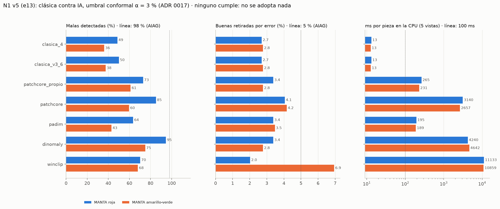
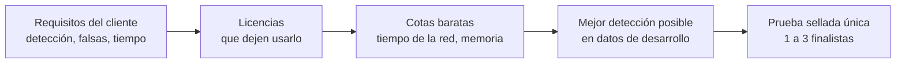
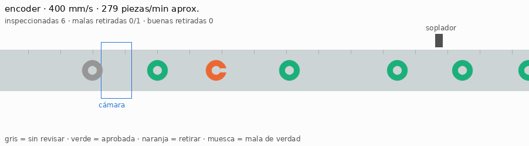
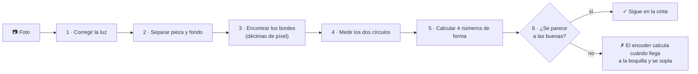
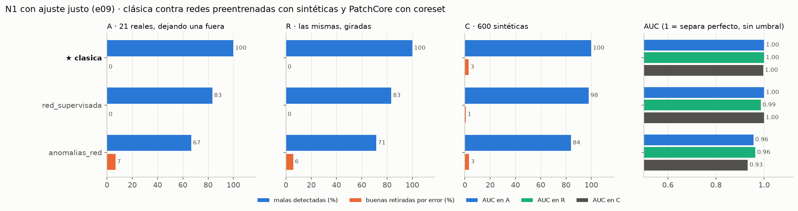
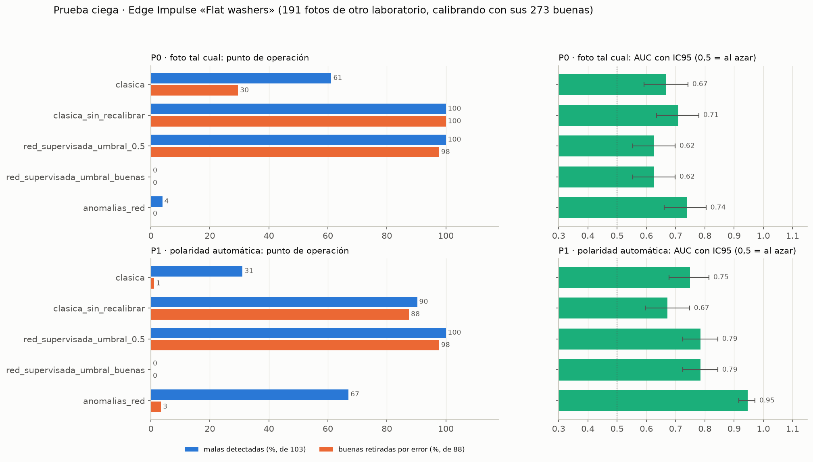
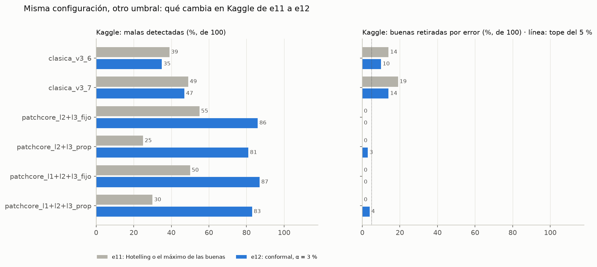

# Inspección de golillas: visión clásica contra IA, con criterios de la industria

Las plantas retiran las golillas defectuosas de una cinta transportadora con una cámara y un soplo de aire. Este repo compara **la visión clásica con 6 métodos de IA de 2020 a 2025** para hacer ese trabajo con un inspector que se calibra por tipo de golilla **solo con piezas buenas**. Todo se mide contra criterios citables de la industria y en un PC sin tarjeta gráfica.

**Resultado de la corrida que decide (e13, 28 nov 2026): ninguno de los 8 métodos cumple** los criterios del AIAG en las dos golillas de prueba. Es un resultado del rigor, no un fracaso: el criterio y la prueba se fijaron antes de mirar los datos, y la prueba se corrió una sola vez.

| Método | Familia | Golilla roja: malas detectadas · buenas retiradas | Golilla amarillo-verde: malas · buenas retiradas | ms por pieza en CPU | Clase AIAG |
|---|---|---|---|---|---|
| Clásica (4 rasgos de forma) | Clásica | 36/74 · 4/148 | 26/72 · 4/144 | **13** | ❌ inaceptable |
| Clásica (6 rasgos, con tamaño) | Clásica | 37/74 · 4/148 | 27/72 · 4/144 | **13** | ❌ inaceptable |
| PatchCore propio | IA sin entrenamiento | 54/74 · 5/148 | 44/72 · 4/144 | 248 | ❌ inaceptable |
| PatchCore (anomalib) | IA sin entrenamiento | 63/74 · 6/148 | 43/72 · 6/144 | 2.899 | ❌ inaceptable |
| PaDiM | IA sin entrenamiento | 47/74 · 5/148 | 31/72 · 5/144 | 192 | ❌ inaceptable |
| AnomalyDINO | IA sin entrenamiento | error de memoria de la GPU del servidor | ídem | — | ❌ no cumple |
| Dinomaly | IA con entrenamiento | **70/74** · 5/148 | **54/72** · 4/144 | 4.441 | ❌ inaceptable |
| WinCLIP | IA con texto | 52/74 · 3/148 | 49/72 · 10/144 | 10.996 | ❌ inaceptable |

**Para cumplir hacía falta:** detectar 73 de 74 y 71 de 72 malas (no detección ≤ 2 %), retirar 7 buenas o menos (falsas alarmas ≤ 5 %) y tardar 100 ms o menos por pieza.



**Decisiones de ingeniería que están detrás:**
- **Los requisitos salen de normas, no del autor.** La detección y las falsas alarmas vienen del criterio «aceptable» del AIAG MSA; la forma de aceptar, de la VDI/VDE/VDMA 2632-3; el informe, de la ISO/IEC TS 4213. Cada número del repo dice de dónde sale ([docs/valores.md](docs/valores.md)).
- **El umbral se calibra con estadística, no a ojo:** un umbral conformal con 3 % de falsas alarmas esperadas, calculado solo con buenas.
- **La prueba estaba sellada:** la huella SHA-256 de cada imagen quedó en un commit antes de abrirla, y la corrida que decide se hizo una vez.
- **Se informa lo que falló y por qué,** incluidos los límites del servidor (una GTX 1060 de 6 GB).

## El método
1. **Requisitos citables, fijados antes de ver los datos** ([ADR 0017](docs/adr/0017-n0-v2-estado-del-arte.md), [ADR 0020](docs/adr/0020-regla-justificacion-de-valores.md)).
2. **Datos públicos con licencia leída:** dos golillas del dataset MANTA (CVPR 2025), con 289–292 buenas que calibran y 222 y 216 piezas de prueba por tipo.
3. **Prueba sellada y corrida única** en el servidor: 382 minutos, con la GPU reservada para que ningún otro trabajo alterara los tiempos.
4. **Informe completo:** matriz de confusión, intervalos de confianza exactos, AUC, detección por tipo de defecto y latencia en CPU y GPU (`resultados/e13_*.csv`).

## Por qué ninguno cumple
- **La clásica es la única que cabe en el tiempo (13 ms), pero no ve la superficie.** Mide forma, y la mayoría de los defectos de MANTA son rayas, manchas y grietas.
- **La IA ve la superficie, pero no llega al 98 %.** Ordena muy bien las piezas: el AUC llega a 0,995, donde 1 es un orden perfecto. Pero con el umbral calibrado, la mejor (Dinomaly) detecta 70/74 y 54/72. Además, ninguna cabe en 100 ms en la CPU.
- **Ni juntándolas alcanza.** Si se retira una pieza cuando cualquiera de los 7 métodos que corrieron la marca, y cada uno usa el mejor umbral posible, se llega a 71/74 y 62/72. Hay malas que todos pierden: 3 abolladuras, 7 rayas, 2 manchas y 1 grieta. Por eso **la decisión falla por detección, aunque el computador fuera más rápido.**
- **Límites del servidor, que no son del método:** Dinomaly se entrenó con lotes de 8 en vez de 32 y se cortó a las 2 h (≈ 3.940 de 5.000 pasos), así que su resultado es una cota inferior. AnomalyDINO se quedó sin memoria de la GPU al medir su tiempo.

## Qué haría para un cliente
No probar todas las combinaciones: cada prueba gasta datos. Usar un embudo que descarte lo imposible antes de la prueba final ([ADR 0019](docs/adr/0019-v6-metodo-de-seleccion.md)):



El [catastro](docs/estado-del-arte.md#8-lo-que-e13-no-compara-catastro-de-la-v6-por-familia-28-nov-2026) ya pasó por ese embudo todo lo que trae anomalib 2.7.1 (33 modelos) y la clásica que falta. Quedan para la próxima versión una clásica que mire la superficie (color, textura y una plantilla dorada), 7 métodos de IA de familias nuevas, modelos optimizados para CPU y combinaciones de clásica con IA.

## Cómo se llevaría a una planta
Lo que ya está medido:
- **El umbral no pasa de un lote a otro.** En Edge Impulse, con el umbral calibrado en otro lote, PatchCore retiró de 10 a 20 de 88 buenas (e12). En planta hay que recalibrar por tipo de golilla, y probablemente por lote.
- **La recalibración se hace solo con buenas,** que es lo que una planta tiene en abundancia.
- **Cuántas buenas hacen falta** lo responde la curva de pocas muestras (`--pocas`: AUC con 1, 4, 16 y 64 piezas), en curso.

Lo que falta, para la v6: la recalibración por lote o turno, la detección de deriva, la cámara, la luz y la óptica (con su costo), y la conexión al soplador o al PLC.

> **Hasta dónde llega este resultado.** Las dos golillas que deciden son **de plástico moldeado**, no de metal: el resultado se traslada solo a medias a golillas metálicas. Y **MANTA se usa con licencia CC BY-NC-SA 4.0:** sirve para este repo abierto, pero no para un cliente comercial. Para una planta haría falta un set sellado nuevo, de la golilla real, con 149 malas o más por tipo.

## Pruébalo
1. Instala [Python](https://www.python.org/downloads/) 3.11 o más nuevo.
2. Descarga el proyecto:
   ```bash
   git clone https://github.com/CarryMankeke/inspeccion-golillas.git
   cd inspeccion-golillas
   ```
3. Crea un entorno e instala:
   ```bash
   python -m venv .venv && source .venv/bin/activate
   pip install -e ".[dev]"
   ```
4. Inspecciona una foto:
   ```bash
   python -m golillas data/real/malas/m01.jpg data/real/buenas/b01.jpg
   ```
   Verás algo así:
   ```text
   RETIRAR   data/real/malas/m01.jpg  (puntaje 72.0 / umbral 56.2, 32 ms)
             · contorno exterior irregular (deformada o con muesca) (fourier_ext: 7 desv.)
             · borde del agujero dañado o cortado (desv_int_p95: 4 desv.)
   APROBADA  data/real/buenas/b01.jpg  (puntaje 5.0 / umbral 56.2, 30 ms)
   ```
5. Corre las pruebas automáticas: `pytest`.

## Glosario corto
- **Golilla**: arandela plana, un anillo con un agujero.
- **AIAG MSA**: manual de la industria automotriz para evaluar sistemas de medición. Su criterio «aceptable» pide no dejar pasar más del 2 % de las malas ni retirar más del 5 % de las buenas.
- **Umbral conformal**: un umbral calculado con buenas que garantiza, en promedio, la tasa de falsas alarmas que se pide (aquí, 3 %).
- **AUC**: qué tan bien ordena un método las piezas, de malas a buenas; 1 es perfecto y 0,5 es azar.
- **Prueba sellada**: datos de prueba fijados con su huella antes de abrirlos, para que nadie elija mirándolos.
- **Cota inferior**: un resultado que podría ser mejor con más recursos.
- **ADR**: nota corta que registra una decisión, sus opciones y su evidencia.

El glosario completo está en [docs/glosario.md](docs/glosario.md).

---

## El camino, de la v1 a la v4
El proyecto partió rehaciendo en Python un inspector MATLAB, con 21 fotos propias. Cada versión destapó un límite y llevó a la siguiente.




### Lo que logró la v1, con 21 fotos propias
| | Resultado |
|---|---|
| Golillas malas reales detectadas (cada foto probada sin haberla visto al calibrar) | **6 de 6** |
| Golillas buenas reales retiradas por error | **0 de 15** |
| Las mismas fotos giradas y en espejo | **42/42 malas y 0/105 buenas retiradas** |
| 600 golillas sintéticas con 6 tipos de defecto | **100 % detectadas, 3 % de falsas alarmas** |
| Tiempo por golilla en un PC sin tarjeta gráfica | **≈ 36 ms** |
| Línea simulada con encoder | **100 % de las malas fuera de la cinta hasta ≈ 1.000 piezas por minuto** |
| **Prueba ciega: 191 fotos de otro laboratorio** (Edge Impulse), calibrando con sus buenas | **32 de 103 malas (31 %) y 1 de 88 buenas retiradas.** Una red de anomalías (PatchCore) detecta 69 de 103 |

Las 21 fotos reales sirvieron para **elegir** técnicas y también para **informar** los números de las primeras filas: son una validación, no una prueba ciega. Con solo 6 malas, "6 de 6" significa "ninguna falla en esta muestra" (intervalo de confianza al 95 %: 54–100 %), no "nunca falla". La prueba ciega con fotos ajenas muestra el límite: el sistema funciona en su montaje, pero no se traslada a otro sin rediseñar el enfoque ([ADR 0013](docs/adr/0013-datos-publicos.md)).

### Cómo funciona la cadena clásica



Los 4 números de forma son: cuánto material falta o sobra en el anillo, cuánto se corre el agujero del centro, qué tan irregular es el contorno exterior y qué tan dañado está el borde del agujero. Cuando el sistema retira una pieza, dice cuál de los cuatro la delató.

### Cómo se decidió cada paso de la v1
El diseño va de lo general a lo particular: primero el objetivo (N0), luego el enfoque (N1), luego los pasos (N2) y, en cada paso, todas las técnicas candidatas probadas con los mismos datos (N3). Cada decisión tiene un registro corto (ADR) con su tabla y su gráfico.

- **Contra qué se compara.** Las reglas del proyecto MATLAB original acertaban 21/21, pero en las mismas fotos con que se ajustaron. Con fotos que no habían visto, detectan 5 de 6 malas y retiran 38 % de las buenas sintéticas ([ADR 0003](docs/adr/0003-n1-linea-base-matlab.md)).
- **Clásica o red neuronal.** Con solo 21 fotos reales, la visión clásica detecta 6/6 malas. Las redes recibieron un ajuste justo: hiperparámetros elegidos con sintéticas de validación, PatchCore con coreset. Aun así, la red ResNet-18 detecta 5/6 y la de anomalías 4/6. La red ResNet-18 ordena tan bien como la clásica (AUC 1,0): lo que le falla es el umbral ([ADR 0004](docs/adr/0004-n1-enfoque.md)).



- **Prueba ciega con fotos ajenas.** En 191 fotos de Edge Impulse, que no se usaron para elegir nada, la clásica detecta 31 % de las malas y PatchCore 67 % (AUC 0,75 contra 0,95). Un tercio de esas «malas» son otra pieza, como golillas de agujero chico o rectangulares, y la clásica no mide tamaño. Además, no ve los cortes finos de las golillas de presión ([ADR 0013](docs/adr/0013-datos-publicos.md)).



El árbol completo, con las 68 opciones probadas en los 7 pasos, está en [docs/arbol.md](docs/arbol.md).

- **v3 y v4.** Ningún candidato cumplió. PatchCore ordena muy bien, y con el umbral conformal de la v4 detecta 86 de 100 malas en Kaggle sin retirar buenas. Pero con solo 15 buenas propias no se puede calibrar ese umbral ([ADR 0014](docs/adr/0014-n1-v3-varios-montajes.md), [ADR 0015](docs/adr/0015-n1-v4-opciones.md)). Una sesión de fotos propias se propuso y se descartó ([ADR 0016](docs/adr/0016-n1-v5-fotos-propias.md)). De ahí sale el estado del arte con datasets públicos (v5, e13).

   

---

## Detalle técnico

### Estructura
```text
golillas/            el paquete: cadena clásica (preproceso … decision), inspector, linea (simulador),
                     conjuntos (cargadores), metodos/ (clásica, PatchCore propio y anomalib), sello
golillas/tipos/      el perfil de cada tipo de golilla (vista de arriba, polaridad, escala)
experimentos/        un script por decisión (e00–e13); cada uno escribe su CSV y su gráfico
scripts/             descarga y sello de datasets, cota de latencia y combinaciones (embudo)
resultados/          CSV de cada experimento y decisiones.json (lo que ganó y con qué criterio)
docs/                ADR, árbol, estado del arte, valores, créditos y glosario; se abre en Obsidian
data/real/           21 fotos propias (15 buenas, 6 malas)
data/sellos/         huellas SHA-256 de las particiones de los datasets públicos (sin imágenes)
tests/               42 pruebas
```

### Reproducir los experimentos
Los scripts se corren desde `experimentos/`. De e00 a e10, cada uno lee la decisión del anterior en `resultados/decisiones.json`.

| Script | Decide |
|---|---|
| `e00b_referencia_real.py` | silueta de referencia de las fotos reales |
| `e01_preproceso_segmentacion.py` | P1 y P2 |
| `e03_bordes.py` · `e04_medicion.py` · `e05_rasgos.py` | P3, P4 y P5 |
| `e06_decision.py` | P6 y `golillas/calibracion.json` |
| `e07_linea.py` | P7, gráficos y GIF de la línea |
| `e00_linea_base_matlab.py` | línea base MATLAB |
| `e08_enfoques.py` · `e09_ajuste_redes.py` | N1: clásica contra redes (con GPU) |
| `e10_prueba_ciega.py` | prueba ciega con Edge Impulse; no decide |
| `e11_n1_v3.py` · `e12_n1_v4.py` | N1 v3 y v4 (ADR 0014 y 0015) |
| `e13_estado_del_arte.py` | N1 v5: estado del arte en MANTA (necesita `pip install -e ".[sota]"`; GTX 1060: 6,4 h). Con `--informa`, `--pocas` y `--figuras`, lo que solo informa |
| `../scripts/combinaciones.py` | embudo del ADR 0019 sobre los puntajes de e13 (solo informa) |
| `portada.py` | la imagen de la v1 |

### Decisiones y métricas de la v1
| Paso | Técnica elegida | Métrica |
|---|---|---|
| P1 Preprocesado | dividir por el fondo estimado | IoU medio 0,946 sobre 11 segmentaciones |
| P2 Segmentación | Otsu | IoU 0,975; topología correcta en 100 % de las buenas; 4 ms |
| P3 Bordes | subpíxel por gradiente | error de radio 0,09 px; dispersión 0,16 px |
| P4 Medición | RANSAC + reajuste geométrico | 0,13 px en buenas; 0,26 px con defecto |
| P5 Rasgos | relleno del anillo, excentricidad, Fourier exterior, desviación interior p95 | AUC 0,998 sintético; 1,0 real |
| P6 Decisión | Mahalanobis con umbral de Hotelling (una clase) | 6/6 y 0/15 dejando una fuera |
| P7 Línea | encoder de 0,1 mm | 100 % retiradas hasta 1.500 mm/s |

### Licencia y créditos
Código MIT ([LICENSE](LICENSE)). Las 21 fotos propias vienen del proyecto MATLAB original. Los datasets públicos no se suben: se bajan con `scripts/descargar_datos.py`, y sus licencias están en [data/ATRIBUCIONES.md](data/ATRIBUCIONES.md). El paper, el código y la licencia de cada método y dataset están en [docs/creditos.md](docs/creditos.md). Para citar el repo, usa [CITATION.cff](CITATION.cff).
