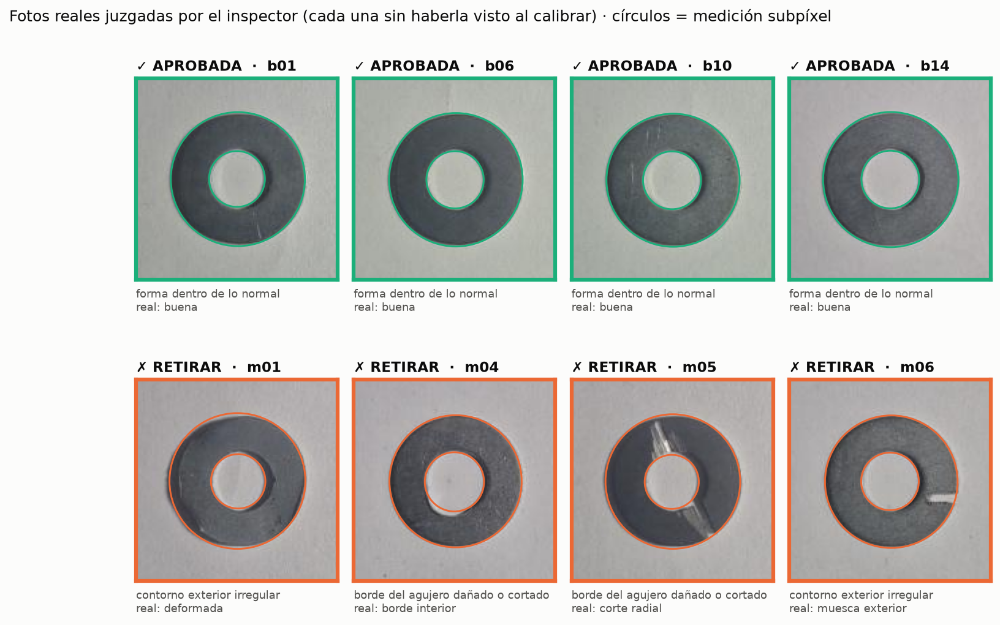
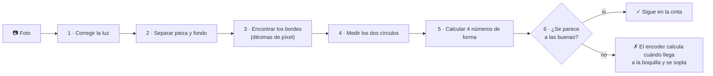
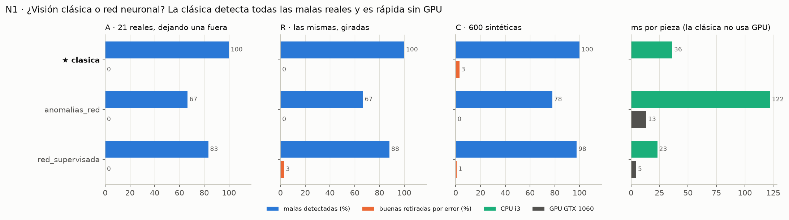

# Inspección de golillas con visión artificial

Una cámara mira cada golilla que pasa por una cinta. Si tiene un defecto, un soplo de aire la saca de la cinta. Cada paso del sistema se eligió comparando varias técnicas con datos, no a ojo.




## Qué logra
| | Resultado |
|---|---|
| Golillas malas reales detectadas (cada foto probada sin haberla visto al calibrar) | **6 de 6** |
| Golillas buenas reales retiradas por error | **0 de 15** |
| Las mismas fotos giradas y en espejo | **42/42 malas y 0/105 buenas retiradas** |
| 600 golillas sintéticas con 6 tipos de defecto | **100 % detectadas, 3 % de falsas alarmas** |
| Tiempo por golilla en un PC sin tarjeta gráfica | **≈ 36 ms** |
| Línea simulada con encoder | **100 % de las malas fuera de la cinta hasta ≈ 1.000 piezas por minuto** |

Las 21 fotos reales sirvieron para **elegir** técnicas y también para **informar** estos números: son una validación, no una prueba ciega. Con solo 6 malas, "6 de 6" significa "ninguna falla en esta muestra" (intervalo de confianza al 95 %: 54–100 %), no "nunca falla". El detalle está en el [ADR 0001](docs/adr/0001-n0-objetivo.md).

## Cómo funciona



Los 4 números de forma son: cuánto material falta o sobra en el anillo, cuánto se corre el agujero del centro, qué tan irregular es el contorno exterior y qué tan dañado está el borde del agujero. Cuando el sistema retira una pieza, dice cuál de los cuatro la delató.

## Cómo se decidió cada paso
El diseño va de lo general a lo particular: primero el objetivo (N0), luego el enfoque (N1), luego los pasos (N2) y, en cada paso, todas las técnicas candidatas probadas con los mismos datos (N3). Cada decisión tiene un registro corto (ADR) con su tabla y su gráfico.

- **Contra qué se compara.** Las reglas del proyecto MATLAB original acertaban 21/21, pero en las mismas fotos con que se ajustaron. Con fotos que no habían visto, detectan 5 de 6 malas y retiran 38 % de las buenas sintéticas ([ADR 0003](docs/adr/0003-n1-linea-base-matlab.md)).
- **Clásica o red neuronal.** Con solo 21 fotos reales, la visión clásica detecta 6/6 malas; una red ResNet-18 ajustada detecta 5/6, y una de detección de anomalías, 4/6 ([ADR 0004](docs/adr/0004-n1-enfoque.md)).



El árbol completo, con las 68 opciones probadas en los 7 pasos, está en [docs/arbol.md](docs/arbol.md).

## Pruébalo
1. Instala [Python](https://www.python.org/downloads/) 3.11 o más nuevo.
2. Descarga el proyecto:
   ```bash
   git clone https://github.com/CarryMankeke/inspeccion-golillas.git
   cd inspeccion-golillas
   ```
3. Crea un entorno e instala:
   ```bash
   python -m venv .venv && source .venv/bin/activate
   pip install -e ".[dev]"
   ```
4. Inspecciona una foto:
   ```bash
   python -m golillas data/real/malas/m01.jpg data/real/buenas/b01.jpg
   ```
   Verás algo así:
   ```text
   RETIRAR   data/real/malas/m01.jpg  (puntaje 72.0 / umbral 56.2, 32 ms)
             · contorno exterior irregular (deformada o con muesca) (fourier_ext: 7 desv.)
             · borde del agujero dañado o cortado (desv_int_p95: 4 desv.)
   APROBADA  data/real/buenas/b01.jpg  (puntaje 5.0 / umbral 56.2, 30 ms)
   ```
5. Corre las pruebas automáticas: `pytest`.

## Glosario corto
- **Golilla**: arandela plana, un anillo de metal con un agujero.
- **ADR**: nota corta que registra una decisión, sus opciones y su evidencia.
- **Falsa alarma**: una golilla buena que el sistema manda a retirar.
- **Dejando una fuera**: se calibra con 20 fotos y se prueba en la que quedó fuera, 21 veces.
- **Encoder**: sensor que mide cuánto avanzó la cinta.

El glosario completo está en [docs/glosario.md](docs/glosario.md).

---

## Detalle técnico

### Estructura
```text
golillas/            el paquete: preproceso, segmentacion, bordes, medicion, rasgos,
                     decision, inspector (la cadena final), linea (simulador), sintetico
golillas/calibracion.json   decisión final calibrada con las 15 buenas reales
experimentos/        un script por decisión (e00–e08); cada uno escribe su CSV y su gráfico
resultados/          CSV de cada experimento y decisiones.json (lo que ganó y con qué criterio)
docs/                ADR, árbol y glosario; se abre como bóveda de Obsidian
docs/figuras/        gráficos generados por los experimentos
data/real/           21 fotos (15 buenas, 6 malas) y etiquetas.csv
tests/               pruebas: medición, generador, inspector y simulador
```

### Reproducir los experimentos
Cada script reutiliza su CSV si existe; con `--recalcular` vuelve a medir desde cero. Se corren desde `experimentos/`, en este orden, porque cada uno lee la decisión del anterior en `resultados/decisiones.json`:

| Script | Decide |
|---|---|
| `e00b_referencia_real.py` | silueta de referencia de las fotos reales |
| `e01_preproceso_segmentacion.py` | P1 y P2 |
| `e03_bordes.py` | P3 |
| `e04_medicion.py` | P4 |
| `e05_rasgos.py` | P5 |
| `e06_decision.py` | P6 y `golillas/calibracion.json` |
| `e07_linea.py` | P7, gráficos y GIF de la línea |
| `e00_linea_base_matlab.py` | línea base MATLAB |
| `e08_enfoques.py` | N1: clásica contra redes (necesita `pip install -e ".[red]"`; con GPU tarda unos 3 min) |
| `portada.py` | la imagen del inicio de este README |

### Decisiones y métricas clave
| Paso | Técnica elegida | Métrica |
|---|---|---|
| P1 Preprocesado | dividir por el fondo estimado | IoU medio 0,946 sobre 11 segmentaciones |
| P2 Segmentación | Otsu | IoU 0,975; topología correcta en 100 % de las buenas; 4 ms |
| P3 Bordes | subpíxel por gradiente | error de radio 0,09 px; dispersión 0,16 px |
| P4 Medición | RANSAC + reajuste geométrico | 0,13 px en buenas; 0,26 px con defecto |
| P5 Rasgos | relleno del anillo, excentricidad, Fourier exterior, desviación interior p95 | AUC 0,998 sintético; 1,0 real |
| P6 Decisión | Mahalanobis con umbral de Hotelling (una clase) | 6/6 y 0/15 dejando una fuera |
| P7 Línea | encoder de 0,1 mm | 100 % retiradas hasta 1.500 mm/s |

### Limitaciones y próximos pasos
Lo que hoy limita los resultados:
- **Pocas fotos reales y sin prueba ciega.** Las 21 fotos se usaron para elegir y para informar (6 malas; IC95 54–100 %).
- **Redes sin ajuste justo.** En el N1, las redes corrieron con hiperparámetros fijos y entrenadas con 20 fotos; "la clásica gana" vale en ese marco ([ADR 0004](docs/adr/0004-n1-enfoque.md)).
- **Una configuración por técnica.** Cada técnica de la cadena clásica corrió con una sola configuración, y se eligió proceso a proceso, sin probar de punta a punta las 2 mejores de cada paso.
- La línea es simulada: la oscilación de la cinta, el resbalamiento y los retardos son supuestos.
- El generador sintético no imita bien la textura del metal ([ADR 0005](docs/adr/0005-datos-sinteticos.md)).
- El port de las reglas MATLAB no se verificó contra MATLAB.

Próximos pasos (versión 2):
1. Sumar un dataset público de golillas con licencia abierta. Su parte real queda como prueba ciega, sin usarla para elegir nada.
2. Ajuste justo de las redes (e09): preentrenar con sintéticas, buscar hiperparámetros en validación sintética, PatchCore con coreset, e informar el AUC.
3. Ajustar los hiperparámetros de la cadena clásica y probar de punta a punta las 2 mejores técnicas de cada proceso.
4. Enfoques N1 que faltan: plantilla dorada y desenrollado polar del anillo.
5. Diámetro en mm con su incertidumbre: calibrar píxel → mm y medir la repetibilidad.
6. Robustez a la luz, al desenfoque y a la altura de la cámara, y latencia en Raspberry Pi o Jetson.
7. Un set nuevo de 30–50 fotos reales tomado aparte, como prueba ciega.

### Licencia
MIT ([LICENSE](LICENSE)). Las 21 fotos reales vienen del proyecto MATLAB original.
