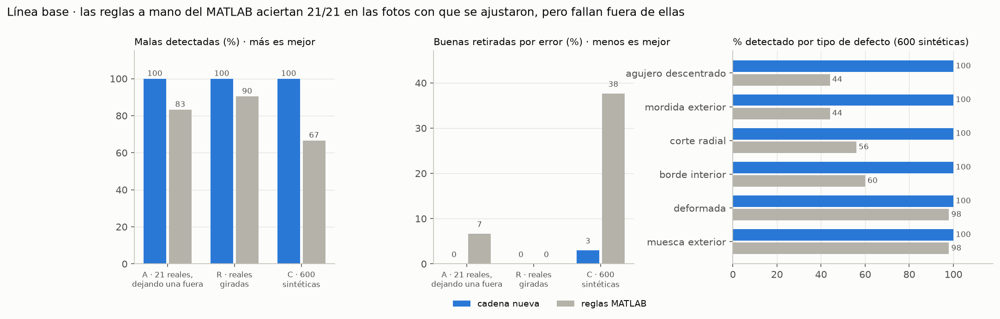

# ADR 0003 · N1: línea base, las reglas del MATLAB original

**Estado:** aceptada · **Fecha:** 2026-11-27 · **Nivel:** N1 · **Script:** `experimentos/e00_linea_base_matlab.py`

## Contexto
El proyecto original (`classifyWasher.m`) aprobaba una golilla si cumplía 5 reglas a mano: una sola mancha, número de Euler 1, circularidad entre 0,8 y 1,2, solidez ≥ 0,95 y exactamente un agujero encontrado con la transformada de Hough (radio exterior entre 50 y 54 px). Informó **21/21 aciertos**, pero con los umbrales ajustados mirando esas mismas 21 fotos y sin probarlas aparte.

## Qué se hizo
Se portaron las reglas a Python y se midieron con las mismas pruebas que la cadena nueva. Dos detalles del port:
- La binarización adaptativa de MATLAB se aproximó con Bradley sobre la oscuridad, con la constante que más se parece a las figuras originales (circularidad 0,88 contra 0,85 del MATLAB en la misma foto).
- La "sensibilidad" del Hough de MATLAB no tiene equivalente exacto. Se reemplazó por dos umbrales de soporte (exterior y agujero), elegidos para acertar las 21 fotos, igual que el original.

## Resultado
| Prueba | Reglas MATLAB | Cadena nueva |
|---|---|---|
| Resustitución (las 21 con que se ajustó) | 21/21 | — |
| A · dejando una fuera: malas detectadas | 5/6 (83 %) | **6/6** |
| A · buenas retiradas por error | 1/15 (7 %) | **0/15** |
| R · fotos giradas: malas detectadas | 90 % | **100 %** |
| C · 600 sintéticas: malas detectadas | 67 % | **100 %** |
| C · buenas retiradas por error | 38 % | **3 %** |

Por tipo de defecto, las reglas detectan bien lo que cambia el contorno exterior (deformada y muesca: 98 %) y mal lo que pasa dentro del anillo (agujero descentrado y mordida: 44 %). La causa: la circularidad y la solidez se calculan **después de rellenar el agujero**, así que no ven nada de lo que pasa dentro; y la regla del número de Euler nunca puede fallar por la misma razón.

Si se dejan solo las sintéticas con el mismo radio que las fotos reales, las falsas alarmas siguen en 35 %: el problema no es solo el rango de radio fijo, sino que los umbrales se ajustaron a 21 fotos.

## Decisión
Las reglas del MATLAB quedan como **línea base**: lo mínimo que hay que superar. La cadena nueva las supera en todas las pruebas.

## Límites de esta comparación
- El port no se verificó contra MATLAB (el servidor no lo tiene).
- La prueba C favorece a la cadena nueva: sus rasgos se eligieron con sintéticas del mismo generador. Las pruebas A y R son las justas.

Volver al [árbol](../arbol.md).
