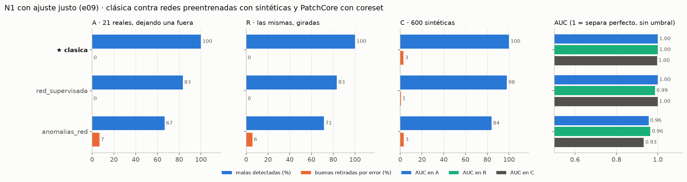
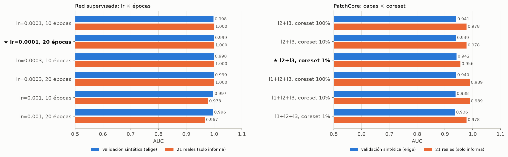

# ADR 0004 · N1: visión clásica o red neuronal

**Estado:** aceptada para el montaje propio; **en revisión**, porque la prueba ciega (e10) muestra que no se generaliza · **Fecha:** 2026-11-27 · **Nivel:** N1 · **Scripts:** `experimentos/e08_enfoques.py`, `experimentos/e09_ajuste_redes.py`, `experimentos/e10_prueba_ciega.py`

## Contexto
Hoy muchas inspecciones visuales se resuelven con redes neuronales. Antes de quedarse con la visión clásica había que medirla contra ellas con las mismas pruebas. La primera comparación (e08) dejó a las redes en desventaja, así que se repitió con un ajuste justo (e09).

## Opciones
1. **Visión clásica**: la cadena de 6 procesos de los ADR 0006 a 0011 (decide con Mahalanobis).
2. **Red supervisada**: ResNet-18 preentrenada en ImageNet, ajustada para "buena/mala" con giros, espejos y cambios de contraste. Necesita ejemplos de malas.
3. **Anomalías con red (PatchCore)**: la misma ResNet-18 sin reentrenar. Guarda trozos de las imágenes buenas y marca una pieza si algún trozo no se parece a ninguno. Solo necesita buenas.

Las dos redes reciben el recorte centrado en la golilla que entrega la segmentación clásica: 160 px alrededor del centro, agrandados a 224 px.

## Criterio
Primero, detectar el 100 % de las malas reales (prueba A dejando una fuera y prueba R con giros). Luego, menos falsas alarmas. Si empatan, la más rápida en CPU, porque el PC de la línea no tiene por qué tener GPU. El AUC se informa, pero no decide.

## El ajuste justo (e09), fijado antes de correr
- **Red supervisada**: primero aprende con las 600 sintéticas de entrenamiento. Se buscan la tasa de aprendizaje {1e-4, 3e-4, 1e-3} y las épocas {10, 20} con **600 sintéticas de validación nuevas** (semilla 9), nunca con las reales. Después, en cada vuelta de la prueba A, se ajusta con las 20 reales de esa vuelta con una receta fija: lr/10, 10 épocas.
- **PatchCore**: se prueban las capas (layer2+3 contra layer1+2+3) y el coreset (100 %, 10 % y 1 % del banco) con la misma validación sintética. El umbral se fija por LOO interno: el mayor puntaje entre las buenas del banco, cada una comparada contra las demás.
- **AUC**: mide qué tan bien ordena un método, sin depender del umbral. 1,0 significa que todas las malas puntúan más alto que todas las buenas.

## Resultado
| Enfoque | A: malas | A: falsas | AUC en A | R: malas | R: falsas | C: malas | C: falsas | ms CPU | ms GPU |
|---|---|---|---|---|---|---|---|---|---|
| **Clásica ★** | **6/6** | **0/15** | **1,00** | **100 %** | **0 %** | 100 % | 3,0 % | 36 | — |
| Red supervisada (e09) | 5/6 | 0/15 | 1,00 | 83 % | 0 % | 98 % | 0,7 % | 21 | 3 |
| PatchCore (e09) | 4/6 | 1/15 | 0,96 | 71 % | 5,7 % | 84 % | 3,3 % | 18 | 2 |
| *Red supervisada (e08)* | *5/6* | *0/15* | — | *88 %* | *2,9 %* | *98 %* | *0,7 %* | *23* | *5* |
| *PatchCore (e08)* | *4/6* | *0/15* | — | *67 %* | *0 %* | *78 %* | *0 %* | *122* | *13* |

Configuraciones elegidas en validación sintética: red supervisada con lr = 1e-4 y 20 épocas; PatchCore con layer2+3 y coreset del 1 %, que deja 940 trozos en el banco de las 15 buenas.

## Decisión
**Se mantiene la visión clásica.** Con el ajuste justo sigue siendo la única que detecta las 6 malas reales y todos sus giros.

## Lo que cambió con e09
- **La red supervisada ordena tan bien como la clásica (AUC 1,0), pero su umbral de 0,5 deja pasar 1 de 6 malas.** Bajar el umbral para que pase la prueba sería elegirlo con las mismas 6 malas con que se mide. Eso queda para un set real que no participe en ninguna decisión ([ADR 0013](0013-datos-publicos.md)).
- **La validación sintética no distingue entre configuraciones.** Las 6 de la red supervisada dan entre 0,996 y 0,999. En las reales, la de 10 épocas habría detectado 6/6, pero eso se ve solo mirando las reales, así que no se usó para elegir. Lo mismo pasa con PatchCore: con layer1+2+3 da 5/6 en reales (solo informativo).
- **PatchCore pasó de 122 ms a 18 ms en CPU** gracias al coreset. Los 122 ms de e08 además se midieron con un banco de solo 5 buenas.
- **Corrección a e08:** decía que los defectos chicos «se diluyen al reducir el recorte a 224 px». No es así: el recorte de 160 px se agranda a 224. Por qué PatchCore deja pasar malas sigue **sin explicar**. Una pista (solo informativa) es que mejora al sumar layer1, la capa de detalle más fino.

## Límites
- Todo sigue medido con 21 fotos reales y 6 malas. Cuando una prueba separa perfecto, el bootstrap del AUC da un intervalo de [1, 1], que no informa nada.
- El umbral de 0,5 y la receta del ajuste con reales quedaron fijos, sin buscar.
- La prueba ciega con datos públicos ya se corrió: ver la sección siguiente.

## Prueba ciega (e10): el resultado no se sostiene fuera del montaje propio
Con 191 fotos de otro laboratorio (Edge Impulse; detalle en el [ADR 0013](0013-datos-publicos.md)), calibrando cada enfoque con 273 buenas de ese montaje:

| Enfoque | Malas detectadas (de 103) | Buenas retiradas (de 88) | AUC (IC95) |
|---|---|---|---|
| Clásica | 32 (31 %) | 1 | 0,75 (0,68–0,81) |
| Red supervisada | 103 o 0, según el umbral | 86 o 0 | 0,79 (0,72–0,84) |
| **PatchCore** | **69 (67 %)** | **3** | **0,95 (0,92–0,97)** |

- **Ningún enfoque cumple el criterio** de detectar el 100 %.
- **PatchCore ordena mucho mejor**, porque solo necesita piezas buenas del montaje nuevo.
- **La clásica falla por diseño**: no mide tamaño, así que no ve las golillas de agujero chico, y no ve cortes radiales finos.

**La decisión no se cambia con esta prueba**, porque elegir con ella le quitaría lo ciego. Lo que sí cambia es lo que se puede afirmar: «la clásica gana» vale para el montaje propio y para defectos de forma, no en general.

**Qué sigue (v3):** reabrir el N1 con PatchCore como candidato principal y una clásica con rasgos de tamaño (razón de radios y radio exterior). Se elige con varios montajes y se prueba con 50 fotos propias nuevas, porque Roboflow no trae golillas buenas y el set de prueba de Edge Impulse ya se vio. El plan y su criterio, fijados antes de correr, están en el [ADR 0014](0014-n1-v3-varios-montajes.md). **Resultado (e11):** ningún candidato cumple. Las clásicas con más rasgos pierden el 6/6 propio, y PatchCore ordena bien pero su umbral es demasiado prudente. Esta decisión sigue en revisión, y las opciones para la v4 están en el [ADR 0015](0015-n1-v4-opciones.md).

## Consecuencias
- La cadena clásica explica sus decisiones («borde del agujero dañado»); las redes no.
- La red supervisada es una candidata seria si se calibra su umbral con datos que no sean los de la prueba. En la prueba ciega se miden los tres enfoques.

Volver al [árbol](../arbol.md).
