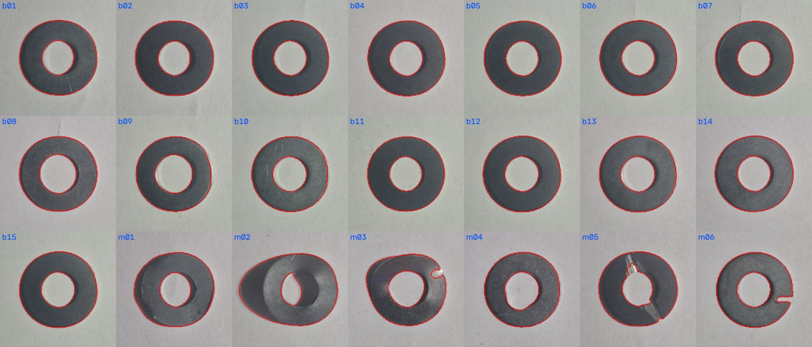

# ADR 0005 · Datos: 21 fotos reales y un generador de golillas sintéticas

**Estado:** aceptada · **Fecha:** 2026-11-27 · **Módulos:** `golillas/sintetico.py`, `experimentos/e00b_referencia_real.py`

## Contexto
Hay 21 fotos reales y ninguna tiene marcada a mano la silueta de la golilla. Con eso no se puede medir el error de un borde en décimas de píxel, ni probar defectos que no aparecen en las fotos.

## Decisión
1. **Generador sintético** con verdad exacta. Dibuja cada golilla 4 veces más grande y la reduce (bordes suaves como en una cámara). Agrega sombra, reflejo, rayas, desenfoque y compresión JPEG. Los rangos (radio 46–58 px, agujero 0,36–0,46 del radio, brillo, desenfoque) se ajustaron a las fotos reales. Genera 6 defectos: deformada, muesca exterior, corte radial, borde interior, mordida exterior y agujero descentrado.
2. **Referencia para las reales**: la silueta que eligen por mayoría 16 segmentaciones distintas. Solo es confiable en las buenas: en dos malas la mayoría se equivoca (incluye la sombra o pierde un brillo).

## Cómo se usan
- Entrenamiento: 600 sintéticas (300 buenas + 50 por defecto, semilla 5).
- Prueba: otras 600 (semilla 6), que no se miran hasta el proceso 6.
- Las 21 reales se usan con la prueba dejando una fuera (A) y con sus 7 versiones giradas (R).

## Lo que no se traslada a las fotos reales (sim2real)
- Un rasgo de textura separa malas reales con AUC 0,93, pero en sintéticas no sirve (0,51): el generador no imita bien esa textura. Por eso no se eligió.
- Los modelos de una clase calibrados solo con sintéticas marcan como malas el 100 % de las buenas reales (prueba B en el [ADR 0011](0011-p6-decision.md)). La decisión final se calibra con las 15 buenas reales.

Volver al [árbol](../arbol.md).
