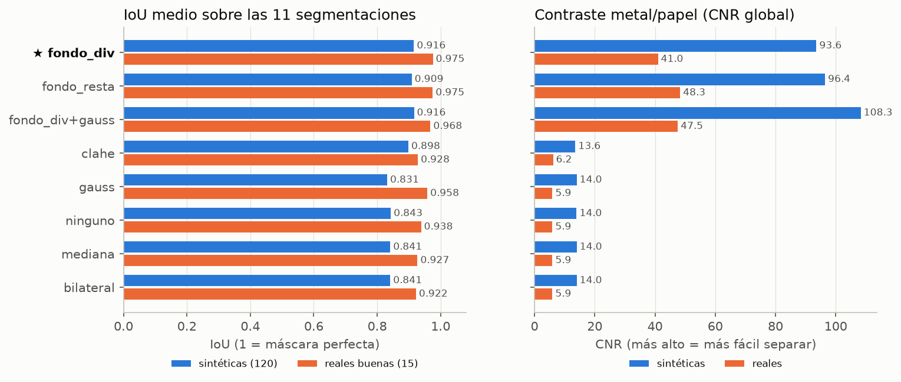
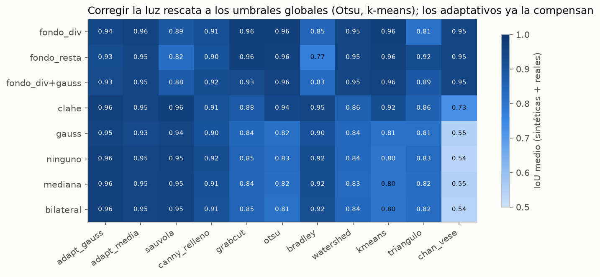
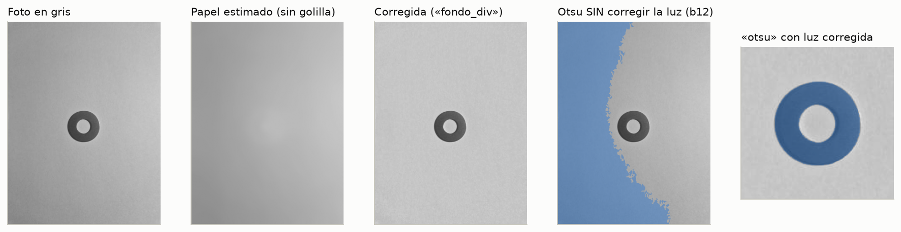

# ADR 0006 · P1 Preprocesado: dividir por el fondo

**Estado:** aceptada · **Fecha:** 2026-11-27 · **Nivel:** N3 · **Script:** `experimentos/e01_preproceso_segmentacion.py`

## Contexto
La luz no es pareja: un lado de la foto es más claro que el otro y la golilla deja sombra. Si eso no se corrige, un umbral único corta mal la pieza.

## Opciones (8)
ninguno, gauss, mediana, bilateral, CLAHE, restar el fondo, dividir por el fondo y dividir por el fondo + gauss. El "fondo" se estima con un cierre morfológico grande a ¼ de resolución, que borra la golilla y deja solo la iluminación.

## Criterio
Cada preprocesado se combina con las 11 segmentaciones del proceso 2 (88 combinaciones), en 120 sintéticas y las 15 buenas reales. Gana el de mayor IoU medio sobre todas las segmentaciones: el mejor preprocesado es el que ayuda a cualquier segmentación, no solo a una.

## Resultado
| Preprocesado | IoU real | IoU sintético | IoU medio | Contraste (CNR) real | ms |
|---|---|---|---|---|---|
| **dividir por el fondo ★** | 0,975 | 0,916 | **0,946** | 41,0 | 2,3 |
| restar el fondo | 0,975 | 0,909 | 0,942 | 48,3 | 2,2 |
| dividir + gauss | 0,968 | 0,916 | 0,942 | 47,5 | 2,5 |
| CLAHE | 0,928 | 0,898 | 0,913 | 6,2 | 1,8 |
| gauss | 0,958 | 0,831 | 0,895 | 5,9 | 0,4 |
| ninguno | 0,938 | 0,843 | 0,891 | 5,9 | 0,2 |
| mediana | 0,927 | 0,841 | 0,884 | 5,9 | 0,8 |
| bilateral | 0,922 | 0,841 | 0,882 | 5,9 | 2,6 |

## Decisión
**Dividir por el fondo.** Multiplica por 7 el contraste entre pieza y fondo y deja la iluminación plana. Los filtros de ruido (gauss, mediana, bilateral) no ayudan, porque el problema es la luz y no el ruido.

Volver al [árbol](../arbol.md).
