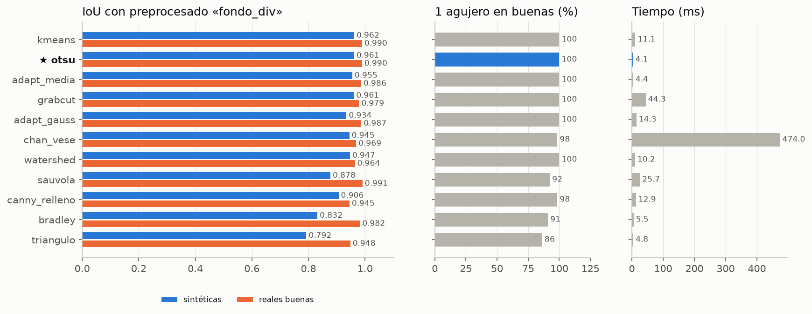

# ADR 0007 · P2 Segmentación: Otsu

**Estado:** aceptada · **Fecha:** 2026-11-27 · **Nivel:** N3 · **Script:** `experimentos/e01_preproceso_segmentacion.py`

## Contexto
Hay que marcar qué píxeles son golilla. La silueta tiene que salir con su agujero (un anillo), porque los rasgos del proceso 5 miden ese agujero.

## Opciones (11)
Otsu, triángulo, adaptativo por media, adaptativo gaussiano, Bradley (el del MATLAB original), Sauvola, k-means, Canny + relleno, GrabCut, watershed y Chan-Vese. Todas sobre la imagen ya dividida por el fondo y con la misma limpieza: quedarse con la mancha más grande y rellenar huecos chicos.

## Criterio
Mayor IoU (promedio de sintéticas y reales) entre las que dejan la topología correcta (una pieza con un agujero) en el **100 % de las buenas**. Si dos quedan a menos de 0,005, gana la más rápida.

## Resultado
| Segmentación | IoU real | IoU sintético | IoU medio | Topología en buenas | ms |
|---|---|---|---|---|---|
| k-means | 0,990 | 0,962 | 0,976 | 100 % | 11,1 |
| **Otsu ★** | 0,990 | 0,961 | 0,975 | 100 % | **4,1** |
| adaptativo media | 0,986 | 0,955 | 0,971 | 100 % | 4,4 |
| GrabCut | 0,979 | 0,961 | 0,970 | 100 % | 44,3 |
| adaptativo gauss | 0,987 | 0,934 | 0,961 | 100 % | 14,3 |
| Chan-Vese | 0,969 | 0,945 | 0,957 | 98,5 % | 474 |
| watershed | 0,964 | 0,947 | 0,955 | 100 % | 10,2 |
| Sauvola | 0,991 | 0,878 | 0,934 | 92,4 % | 25,7 |
| Canny + relleno | 0,945 | 0,906 | 0,926 | 98,5 % | 12,9 |
| Bradley | 0,982 | 0,832 | 0,907 | 90,9 % | 5,5 |
| triángulo | 0,948 | 0,792 | 0,870 | 86,4 % | 4,8 |

## Decisión
**Otsu.** Empata con k-means (diferencia 0,001) y es casi 3 veces más rápido. Con la luz ya corregida en el proceso 1, un umbral global basta.

## Revisión del criterio
La primera versión exigía topología correcta en ≥ 95 % de **todas** las golillas con agujero. Ningún método lo cumplía, porque en las deformadas el anillo se abre con cualquier técnica. Pero esas golillas se rechazan igual, así que se cambió a "100 % en las buenas", que es lo que importa para no botar piezas sanas.

Volver al [árbol](../arbol.md).
