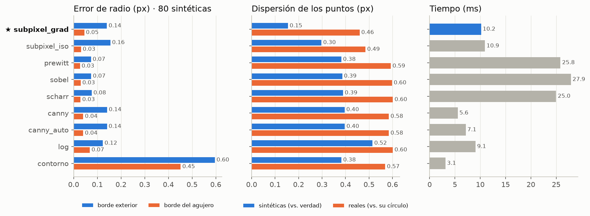

# ADR 0008 · P3 Bordes: subpíxel por gradiente

**Estado:** aceptada · **Fecha:** 2026-11-27 · **Nivel:** N3 · **Script:** `experimentos/e03_bordes.py`

## Contexto
Para medir el círculo (proceso 4) hacen falta puntos del borde exterior y del borde del agujero. Mientras más precisos y menos dispersos, más chico es el defecto que se puede ver.

## Opciones (9)
Sobel, Scharr y Prewitt (con supresión de no máximos), LoG, Canny, Canny automático, contorno de la máscara, subpíxel por isolínea y subpíxel por gradiente (ajusta una parábola al máximo del gradiente, en la dirección del gradiente).

## Criterio
Menor suma de **error de radio** (contra la verdad de las sintéticas) + **dispersión de los puntos** alrededor del círculo verdadero. Empate a menos de 0,05 px → el más rápido.

## Resultado
| Bordes | Error de radio (px) | Dispersión (px) | Suma | ms |
|---|---|---|---|---|
| **subpíxel gradiente ★** | 0,093 | **0,155** | **0,248** | 10,2 |
| subpíxel isolínea | 0,093 | 0,298 | 0,391 | 10,9 |
| Prewitt | 0,050 | 0,382 | 0,432 | 25,8 |
| Sobel | 0,052 | 0,386 | 0,438 | 27,9 |
| Scharr | 0,053 | 0,389 | 0,442 | 25,0 |
| Canny | 0,091 | 0,396 | 0,487 | 5,6 |
| LoG | 0,096 | 0,515 | 0,611 | 9,1 |
| contorno | 0,524 | 0,383 | 0,907 | 3,1 |

## Decisión
**Subpíxel por gradiente.** Tiene la menor dispersión: sus puntos quedan a 0,16 px del círculo verdadero, contra ≈ 0,39 px de los detectores de píxel entero. Esa dispersión es el ruido de fondo de los rasgos del proceso 5. En las fotos reales también da el contorno más liso.

## Revisiones
- **Criterio:** la primera versión miraba solo el error de radio. No servía para decidir, porque todos quedan bajo 0,1 px: el ajuste del círculo promedia el ruido. La dispersión sí separa los métodos.
- **Error corregido:** los umbrales de Canny salían de Otsu sobre la intensidad (unidades equivocadas). En el 7 % de las sintéticas buenas faltaba el borde del agujero y se rechazaban. Ahora salen de un percentil del gradiente en la banda del borde, y se repitieron los procesos 3 a 6.

Volver al [árbol](../arbol.md).
