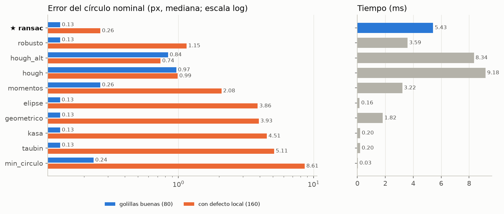

# ADR 0009 · P4 Medición: círculo por RANSAC

**Estado:** aceptada · **Fecha:** 2026-11-27 · **Nivel:** N3 · **Script:** `experimentos/e04_medicion.py`

## Contexto
Con los puntos del borde se ajusta el círculo exterior y el del agujero. Los rasgos del proceso 5 miden cuánto se aleja la pieza de esos círculos. Si una muesca o un corte arrastran el ajuste, el defecto se "reparte" y se ve menos.

## Opciones (10)
Kåsa, Taubin, geométrico (mínimos cuadrados), robusto (pérdida soft-L1), RANSAC, elipse, mínimo círculo envolvente, momentos de la máscara, Hough y Hough alternativo.

## Criterio
Menor promedio entre el error del círculo en golillas **buenas** y en golillas **con defecto** (mediana, en px). El error del círculo es el error de radio más la distancia entre el centro medido y el verdadero. Empate a menos de 0,05 px → el más rápido.

## Resultado
| Ajuste | Error en buenas (px) | Error con defecto (px) | ms |
|---|---|---|---|
| **RANSAC ★** | 0,133 | **0,264** | 5,4 |
| robusto (soft-L1) | 0,133 | 1,150 | 3,6 |
| Hough alternativo | 0,838 | 0,737 | 8,3 |
| Hough | 0,966 | 0,988 | 9,2 |
| momentos | 0,264 | 2,085 | 3,2 |
| elipse | 0,133 | 3,861 | 0,2 |
| geométrico | 0,133 | 3,935 | 1,8 |
| Kåsa | 0,133 | 4,514 | 0,2 |
| Taubin | 0,133 | 5,109 | 0,2 |
| mínimo círculo | 0,236 | 8,608 | 0,03 |

## Decisión
**RANSAC** con 300 hipótesis, tolerancia de 1,5 px y reajuste geométrico con los puntos que acepta. En buenas empata con todos los ajustes clásicos. Con un corte radial, Kåsa se equivoca en 11 px y RANSAC en 0,1 px.

## Revisión
La primera versión de RANSAC tardaba 46 ms. Se vectorizó (todas las hipótesis a la vez con NumPy) y bajó a 5,7 ms con los mismos resultados.

Volver al [árbol](../arbol.md).
