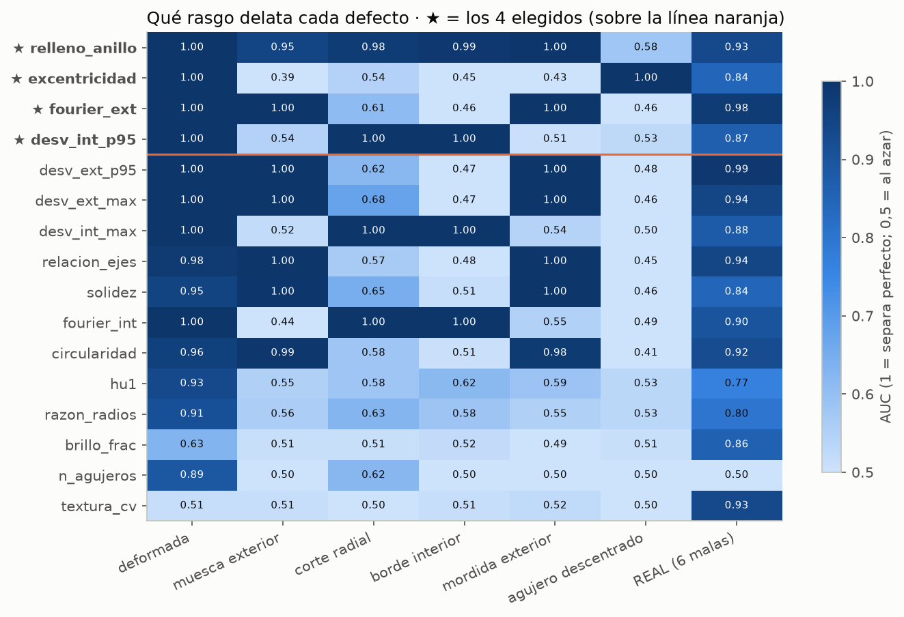

# ADR 0010 · P5 Rasgos: 4 números de forma

**Estado:** aceptada · **Fecha:** 2026-11-27 · **Nivel:** N3 · **Script:** `experimentos/e05_rasgos.py`

## Contexto
La decisión final mira unos pocos números por pieza. Con 15 buenas reales para calibrar, cada rasgo extra hace más difícil estimar qué es "normal", así que conviene usar pocos.

## Opciones (17 rasgos)
Circularidad, solidez, relación de ejes, número de agujeros, desviación máxima y percentil 95 del borde exterior e interior, excentricidad (distancia entre centros), razón de radios, armónicos de Fourier del contorno exterior e interior, relleno del anillo, textura, fracción de brillo, momento de Hu y radio exterior. El radio quedó fuera de la selección: depende de la altura de la cámara y es una tolerancia de tamaño, no de forma.

## Criterio
Selección hacia adelante en las sintéticas de **entrenamiento**. Cada rasgo se convierte en "cuántas MAD se aleja de la mediana de las buenas". En cada paso se agrega el rasgo que más sube el AUC medio por tipo de defecto. Se para cuando mejora menos de 0,002 o hay 6 rasgos.

## Resultado
| Paso | Rasgo agregado | Qué detecta | AUC medio |
|---|---|---|---|
| 1 | relleno del anillo | falta o sobra material | 0,915 |
| 2 | excentricidad | agujero descentrado | 0,981 |
| 3 | Fourier exterior | contorno irregular (deformada, muesca) | 0,991 |
| 4 | desviación interior p95 | borde del agujero dañado o cortado | **0,998** |

En las 21 fotos reales, el máximo de esos 4 puntajes separa malas de buenas con **AUC 1,0**.

## Decisión
**relleno del anillo, excentricidad, Fourier exterior y desviación interior p95.** Cada uno cubre un tipo de defecto distinto, y el inspector usa sus nombres para explicar por qué retira una pieza.

## Tiempo de toda la cadena (mediana por foto)
Preprocesado 2,9 ms · segmentación 4,7 ms · bordes 10,8 ms · medición 5,7 ms · rasgos 12,2 ms → **≈ 36 ms**.

## Lo que no se trasladó
El rasgo de textura separa las malas reales (AUC 0,93), pero no las sintéticas (0,51), porque el generador no imita la textura. No se eligió: habría sido elegirlo mirando las fotos de prueba.

Volver al [árbol](../arbol.md).
