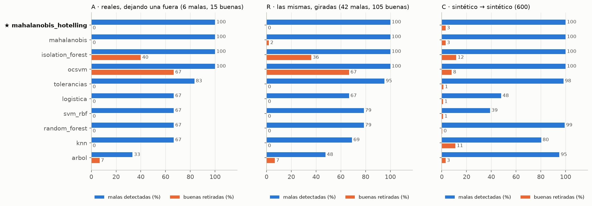
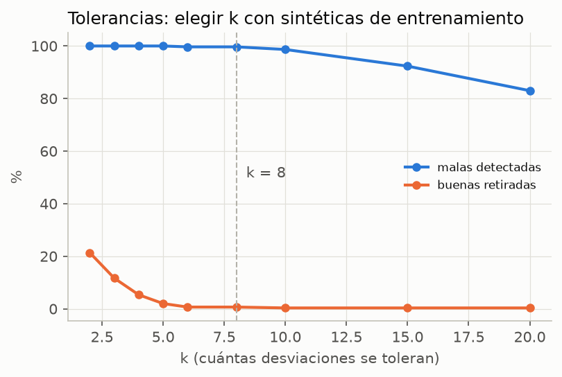

# ADR 0011 · P6 Decisión: Mahalanobis con umbral de Hotelling

**Estado:** aceptada · **Fecha:** 2026-11-27 · **Nivel:** N3 · **Script:** `experimentos/e06_decision.py`

## Contexto
Con los 4 rasgos hay que decidir "aprobar" o "retirar". Hay 15 buenas y solo 6 malas reales, y en planta lo normal es tener muchas piezas buenas de referencia y pocas malas.

## Opciones (10)
- **De una clase** (solo ven buenas): tolerancias por rasgo (mediana ± k·MAD), Mahalanobis con umbral χ², Mahalanobis con umbral de Hotelling, Isolation Forest, One-Class SVM.
- **Supervisados** (ven buenas y malas): regresión logística, árbol, SVM, random forest, k-NN.

## Pruebas
- **A**: 21 reales, dejando una fuera.
- **R**: las 7 versiones giradas de la foto que quedó fuera (147 casos).
- **B**: calibrar solo con sintéticas y probar en las 21 reales.
- **C**: 600 sintéticas de entrenamiento → 600 de prueba.

## Criterio
Entre los que detectan 6/6 malas en A y ≥ 99 % en R, el de menos falsas alarmas (A y R). Empate → mejor en C. Si sigue el empate, uno de una clase.

## Resultado
| Modelo | Tipo | A: malas | A: falsas | R: malas | R: falsas | C: malas | C: falsas |
|---|---|---|---|---|---|---|---|
| **Mahalanobis + Hotelling ★** | una clase | **6/6** | **0/15** | **100 %** | **0 %** | 100 % | 3,0 % |
| Mahalanobis + χ² | una clase | 6/6 | 0/15 | 100 % | 1,9 % | 100 % | 3,0 % |
| tolerancias (k = 8) | una clase | 5/6 | 0/15 | 95 % | 0 % | 98 % | 1,3 % |
| Isolation Forest | una clase | 6/6 | 6/15 | 100 % | 36 % | 100 % | 11,7 % |
| One-Class SVM | una clase | 6/6 | 10/15 | 100 % | 67 % | 100 % | 8,0 % |
| random forest | supervisado | 4/6 | 0/15 | 79 % | 0 % | 99 % | 0,3 % |
| SVM | supervisado | 4/6 | 0/15 | 79 % | 0 % | 39 % | 1,0 % |
| logística | supervisado | 4/6 | 0/15 | 67 % | 0 % | 48 % | 1,0 % |
| k-NN | supervisado | 4/6 | 0/15 | 69 % | 0 % | 80 % | 11,0 % |
| árbol | supervisado | 2/6 | 1/15 | 48 % | 6,7 % | 95 % | 3,0 % |

Intervalos de confianza al 95 % del elegido en A: malas 6/6 → 54–100 %; falsas 0/15 → 0–22 %.

## Decisión
**Mahalanobis con umbral de Hotelling**, calibrado con las 15 buenas reales (`golillas/calibracion.json`). Los supervisados fallan en A porque aprenden con 5 malas por vuelta. El umbral χ² supone que la forma de las buenas se conoce perfecto; con 14–15 piezas no es así, y retiró 2 de 105 buenas giradas. Hotelling corrige por el tamaño de muestra (umbral ≈ 63 con 14 buenas y 56 con las 15, en vez de 18,5) y queda en 0/105.

## Revisiones
- **Prueba R agregada:** al simular la línea con fotos giradas aparecieron buenas retiradas que la prueba A no mostraba. Desde entonces cada modelo se mide también girando las fotos.
- **Prueba B:** calibrados solo con sintéticas, todos los modelos de una clase y el random forest retiran el 100 % de las buenas reales; los otros supervisados retiran pocas (0–13 %), pero se les escapan entre 1 y 4 de las 6 malas. Por eso la calibración final usa buenas reales, como se haría en planta con piezas patrón.
- El k de las tolerancias se eligió antes, solo con sintéticas de entrenamiento.

Volver al [árbol](../arbol.md).
