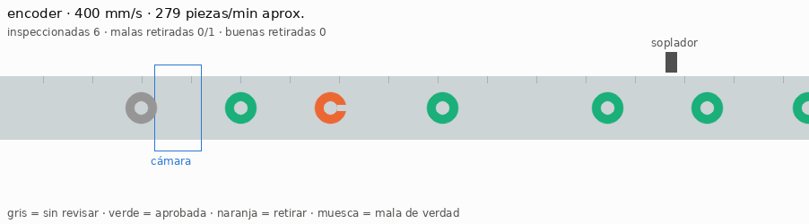
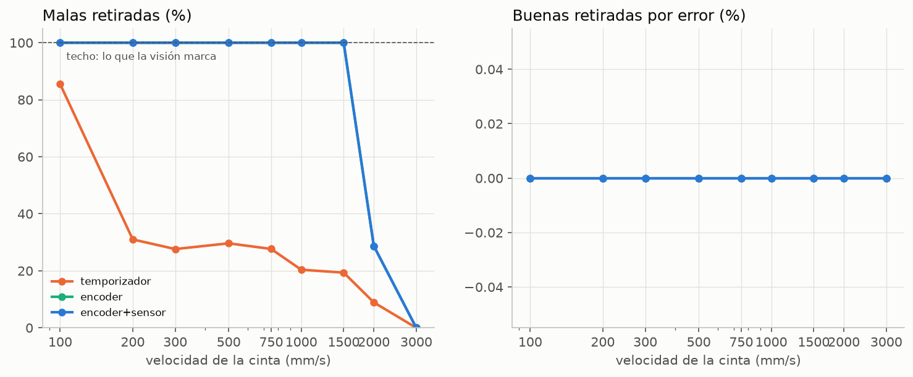
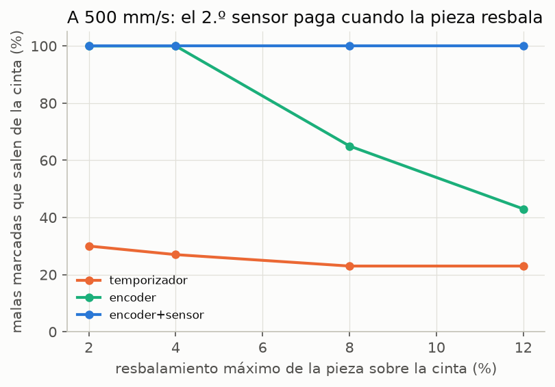

# ADR 0012 · P7 Línea: encoder en la cinta

**Estado:** aceptada · **Fecha:** 2026-11-27 · **Nivel:** N3 · **Script:** `experimentos/e07_linea.py` · **Módulo:** `golillas/linea.py`

## Contexto
Detectar la golilla mala no basta: hay que soplarla justo cuando pasa frente a la boquilla, 250 mm después de la cámara. La cinta no va a velocidad constante (oscila ±8 % y tiene ruido) y las piezas resbalan un poco. El chorro de aire solo saca piezas a ±7 mm de la boquilla.

## Opciones (3)
1. **Temporizador**: soplar a `t_foto + distancia / velocidad nominal`. Supone velocidad constante.
2. **Encoder**: un sensor en el rodillo cuenta el avance real de la cinta (0,1 mm por pulso). Se sopla cuando la cinta avanzó 250 mm desde la foto.
3. **Encoder + segundo sensor**: además, un sensor 40 mm antes de la boquilla vuelve a ubicar la pieza.

## Cómo se simuló
Piezas en fila con separaciones al azar y 10 % de malas. Cada pieza se ve con una variante girada de una foto real, juzgada por un inspector calibrado sin esa foto (detecta el 100 % de las malas y no marca ninguna buena; tarda 43 ms de mediana). Se modela la cola de la visión, la captura (5 ms), la válvula (10 ms) y el soplo (15 ms). Duración: 60 s por caso.

## Criterio
La estrategia más simple que retire ≥ 99 % de las malas marcadas y arrastre ≤ 1 % de buenas en todas las velocidades que la visión alcanza, con resbalamiento de 0 a 4 %.

## Resultado
| Velocidad (mm/s) | Piezas/min | Temporizador | Encoder | Encoder + sensor |
|---|---|---|---|---|
| 100 | 70 | 86 % | **100 %** | 100 % |
| 500 | 349 | 30 % | **100 %** | 100 % |
| 1.000 | 704 | 20 % | **100 %** | 100 % |
| 1.500 | 999 | 19 % | **100 %** | 100 % |
| 2.000 | 1.311 | 9 % | 29 % | 29 % |

(% de malas marcadas que salen de la cinta; ninguna estrategia arrastró buenas.)

A 2.000 mm/s el problema ya no es el seguimiento: la visión no alcanza a decidir antes de que la pieza llegue a la boquilla (71 % llegan tarde).

| Resbalamiento (a 500 mm/s) | Temporizador | Encoder | Encoder + sensor |
|---|---|---|---|
| 0–2 % | 30 % | 100 % | 100 % |
| 0–4 % | 27 % | 100 % | 100 % |
| 0–8 % | 23 % | 65 % | **100 %** |
| 0–12 % | 23 % | 43 % | **100 %** |

## Decisión
**Encoder**, hasta 1.500 mm/s (≈ 1.000 piezas por minuto). Si en la cinta real las piezas resbalan más de 4 %, se agrega el segundo sensor. El temporizador no sirve: con ±8 % de oscilación de velocidad, el error de posición supera los ±7 mm del chorro.

## Límites
Es una simulación: la oscilación, el resbalamiento y los retardos son supuestos razonables, no mediciones de una cinta real.

Volver al [árbol](../arbol.md).
