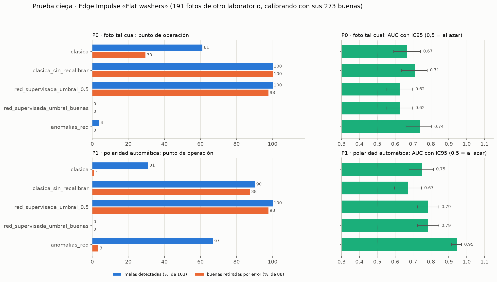
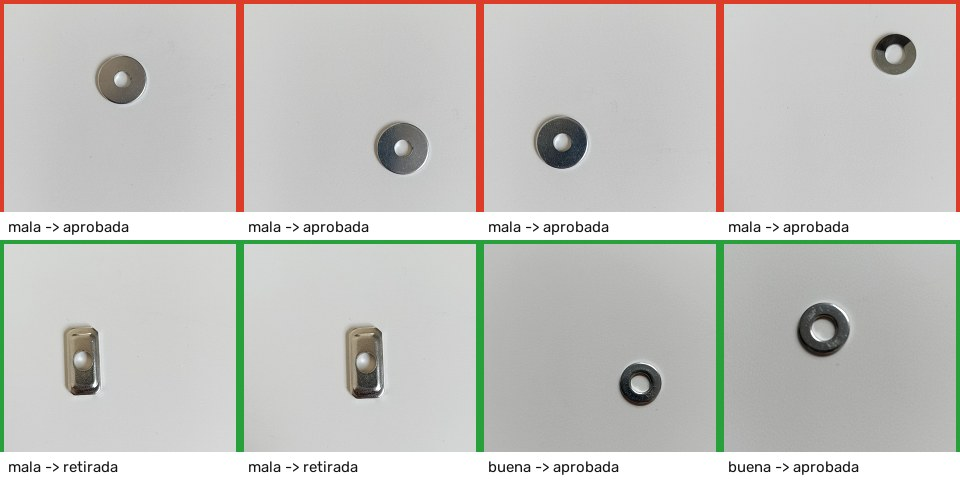

# ADR 0013 · Datos públicos: una prueba ciega con fotos de otros laboratorios

**Estado:** aceptada; prueba ciega corrida con Edge Impulse (e10) · **Fecha:** 2026-11-27 · **Scripts:** `scripts/descargar_datos.py`, `experimentos/e10_prueba_ciega.py`

## Contexto
Las 21 fotos reales sirvieron para elegir y para informar, así que no son una prueba ciega ([ADR 0004](0004-n1-enfoque.md)). Con solo 6 malas, el IC95 de la detección va de 54 % a 100 %. Hace falta validar con muchas más golillas, que nunca hayan participado en una decisión. El código del proyecto es abierto (MIT) y sin uso comercial, así que cada dataset debe tener una licencia que permita usarlo así.

El proyecto MATLAB anterior (`Vision-Artificial-Clasica`, junio 2025) usaba un dataset de internet: «Simplified washers» de Kaggle, que tiene 1.200 golillas. Pero son dibujos, no fotos. Entra en la combinación con ese papel.

## Opciones (licencias leídas en la fuente el 27 nov 2026)
| Dataset | Imágenes (malas) | Defectos | Parecido con nuestro montaje | Licencia | Descarga |
|---|---|---|---|---|---|
| **Edge Impulse «Flat washers»** ([fuente](https://docs.edgeimpulse.com/datasets/image/flat-washers)) | 464: 273 buenas de entrenamiento; prueba 191 = **103 malas** + 88 buenas | Anillo cortado o deformado | **Alto**: fotos reales, una golilla plana vista desde arriba. Fondo blanco o gris oscuro; la golilla cae en cualquier lugar | BSD 3-Clause Clear | Directa, sin cuenta, 37 MB |
| **CSEM-MISD, golillas** ([fuente](https://zenodo.org/records/5513769)) | 50 piezas, todas malas, 108 fotos por pieza | Rayones y abolladuras chicas (0,2–3 % de la pieza) | Bajo: primer plano en gris bajo una cúpula de 108 luces; la forma está intacta | CC BY-NC-ND 4.0 (uso sin modificar ni redistribuir) | Directa, sin cuenta, 888 MB |
| **Roboflow «Washer Defects»** de MassMEP ([fuente](https://universe.roboflow.com/massmep/washer-defects-3usoj)) | 187 (malas: sin desglose) | Rayón, falta de recubrimiento | Medio: golilla negra vista desde arriba sobre fondo gris; los defectos son de superficie, no de forma | CC BY 4.0 | **Pide cuenta de Roboflow** |
| **Kaggle «Simplified washers»** ([fuente](https://www.kaggle.com/datasets/thibdx/simplified-washers-for-anomaly-detection)) | 1.200: 1.000 buenas de entrenamiento; prueba 100 malas + 100 buenas | Dibujados | Bajo: dibujos de 128 px | CC BY-SA 4.0 | **Pide cuenta de Kaggle**; hay una copia en el OneDrive del PC Windows |
| Roboflow «Washer Classifier» ([fuente](https://universe.roboflow.com/cap-inspection-cioib/washer-classifier-fohnr)) | 443 (ok / ng) | Golilla con defecto o doble | Bajo: golillas montadas dentro de tapas negras | CC BY 4.0 | Pide cuenta |
| MVTec AD `metal_nut` | 335 (93 malas, **no verificado**) | Doblada, rayón, color | Medio: tuerca de 4 lóbulos, no golilla | CC BY-NC-SA 4.0 según Hugging Face; **no verificada** porque mvtec.com no abrió | Formulario en mvtec.com |

## Criterio
Primero, fotos reales de golillas con malas etiquetadas. Luego, la cantidad de malas. Luego, la variedad de defectos y montajes. Por último, que la licencia permita el uso abierto y sin fines comerciales.

## Decisión: una combinación por bloques
1. **Edge Impulse (principal).** Es el único con fotos reales de golillas planas buenas y malas. Sus 103 malas son 17 veces las nuestras. Mide detección y falsas alarmas.
2. **CSEM-MISD.** Aporta golillas reales malas, con otra cámara y otra luz. Solo mide detección, porque no trae buenas.
3. **Roboflow MassMEP.** Son defectos de superficie. La cadena clásica mide forma, así que es probable que falle ahí. Sirve para conocer ese límite. Necesita que Camilo cree una cuenta.
4. **Kaggle «Simplified washers».** Es el dataset del proyecto MATLAB anterior. No es prueba real: sirve para comparar con otro generador de dibujos. Hay que bajarlo desde Kaggle con cuenta o copiarlo desde el OneDrive.

Se descartan «Washer Classifier», porque son golillas dentro de tapas, y `metal_nut`, porque no es una golilla.

En total, hasta ~360 malas reales contra las 6 de hoy. Ninguna imagen se sube al repo: el script las baja y verifica su tamaño y su huella.

## Cómo se usa (fijado antes de mirar los datos)
- Las buenas de entrenamiento de cada dataset (273 en Edge Impulse y 1.000 en Kaggle) **calibran**, como las piezas patrón en planta: la media y la covarianza de la clásica, el banco de PatchCore y el ajuste de la red supervisada.
- Las de prueba son la **prueba ciega**: no eligen técnicas, ni umbrales, ni hiperparámetros. Se corren una sola vez con lo elegido hasta hoy. Se informa el resultado de los tres enfoques, sea cual sea.
- Riesgo conocido: los montajes son distintos (fondo blanco, golilla más chica y en cualquier lugar, otra luz). Si la cadena clásica falla ahí, ese es el resultado y se informa.

## Lo que pasó al bajarlos (27 nov 2026)
- **Edge Impulse** y **CSEM-MISD** se bajaron sin cuenta, con su tamaño y su huella verificados. Las huellas SHA-256 quedaron fijadas en el script; CSEM-MISD además calzó con el MD5 que publica Zenodo.
- **CSEM-MISD no sirve para aprobar o retirar.** Son 50 golillas, no 70, y todas tienen defecto: no hay buenas para calibrar ni para medir falsas alarmas. Además, son primeros planos con rayones o abolladuras chicas, y la forma de la pieza está intacta. Queda bajado para un trabajo futuro de segmentación de defectos.
- **Roboflow y Kaggle** piden cuenta, así que no se bajaron. Quedan para Camilo; el Kaggle también está en el OneDrive del PC Windows.

## Resultado de la prueba ciega (e10, Edge Impulse)
Protocolo P1: polaridad automática y sin etiquetas, porque la cadena espera una golilla oscura sobre fondo claro. Cada enfoque se calibra con las 273 buenas.

| Enfoque | Malas detectadas (de 103) | Buenas retiradas (de 88) | AUC (IC95) | Solo fondo claro: malas · falsas |
|---|---|---|---|---|
| Clásica, recalibrada | 32 (31 %) | 1 (1 %) | 0,75 (0,68–0,81) | 14/34 · 0/29 |
| Clásica sin recalibrar | 93 | 77 | 0,67 | 34/34 · 29/29 |
| Red supervisada, umbral 0,5 | 103 | 86 | 0,79 (0,72–0,84) | 34/34 · 27/29 |
| Red supervisada, umbral con buenas | 0 | 0 | 0,79 | 0/34 · 0/29 |
| **PatchCore** | **69 (67 %)** | **3 (3 %)** | **0,95 (0,92–0,97)** | 28/34 · 3/29 |

**Qué es una «mala» en Edge Impulse** (conteo a ojo sobre miniaturas, **no verificado**): de las 103, ~73 son golillas de presión (con un corte radial y torcidas), ~11 rectangulares, ~9 de copa y ~10 de agujero chico. Un tercio son *otra pieza*, no una golilla dañada.

Lectura:
- **La cadena clásica no se generaliza a otro montaje.** Detecta 31 %, y 41 % si se mira solo el fondo claro, que es el montaje que define el [ADR 0001](0001-n0-objetivo.md). Las golillas de agujero chico pasan porque la cadena no mide tamaño: el radio quedó fuera a propósito y la razón de radios no se eligió. Muchas golillas de presión también pasan: un corte de pocos píxeles no alcanza a mover los 4 rasgos.
- **PatchCore es lo que mejor se traslada**, porque solo necesita buenas del montaje nuevo: AUC 0,95.
- **La red supervisada ordena regular (AUC 0,79), pero ningún umbral sirve.** Con 0,5 retira casi todo, y con el umbral calibrado con buenas no retira nada. Lo que aprendió con nuestras fotos y sintéticas no se traslada.
- Sin recalibrar, la clásica retira casi todo: calibrar con piezas buenas del montaje es obligatorio.

Esta prueba **no cambia ninguna decisión**: si se eligiera con ella, dejaría de ser ciega. Lo que sigue está en el [ADR 0004](0004-n1-enfoque.md).

Volver al [árbol](../arbol.md).
