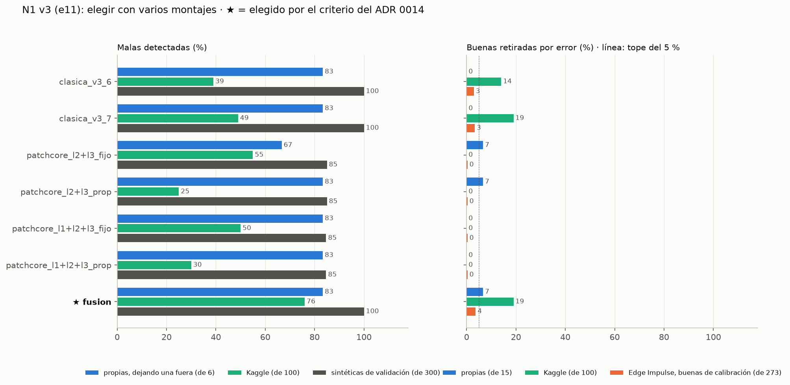

# ADR 0014 · N1 v3: reabrir el enfoque con varios montajes

**Estado:** corrida (e11): **ningún candidato cumple el criterio**; la regla de respaldo eligió la fusión, que no se adopta. Lo que sigue va en el [ADR 0015](0015-n1-v4-opciones.md) · **Fecha:** 2026-11-27 · **Nivel:** N1 · **Scripts:** `experimentos/e11_n1_v3.py` (elección) y la prueba ciega propia, por escribir (pasa a e13 si la v4 usa e12)

## Contexto
En el montaje propio, la visión clásica detecta las 6 malas reales y gana a las redes ([ADR 0004](0004-n1-enfoque.md)). En la prueba ciega con fotos de otro laboratorio (e10, [ADR 0013](0013-datos-publicos.md)) eso no se sostiene: la clásica detecta 31 % de las malas y PatchCore 67 % (AUC 0,75 contra 0,95). La clásica no mide tamaño y no ve cortes radiales finos.

Hay que volver a elegir el enfoque, pero sin hacer trampa: el set de prueba de Edge Impulse ya se vio, así que no puede elegir nada. Por eso esta versión separa desde el principio qué datos eligen y qué datos prueban.

## Qué datos sirven para qué
| Datos | Buenas | Malas | Papel en v3 |
|---|---|---|---|
| 21 fotos propias | 15 | 6 | **Elegir**: prueba A (dejando una fuera) y prueba R (con giros), como en e06 y e09 |
| Sintéticas de validación de e09 (semilla 9) | 300 | 300 (50 de cada uno de los 6 defectos) | **Elegir** |
| Kaggle «Simplified washers» (dibujos) | 1.000 calibran; 100 de prueba | 100 | **Elegir**: es otro montaje con malas y nunca se ha usado. Bajado el 27 nov 2026 |
| Edge Impulse, 273 buenas de entrenamiento | 273 | 0 | **Elegir, solo falsas alarmas**: cada buena se compara con las demás (dejando una fuera) |
| Edge Impulse, 191 de prueba | 88 | 103 | **No elige.** Ya se vio en e10. Se vuelve a correr al final y se informa marcado «no ciego» |
| Roboflow MassMEP | 0 | 187 | No sirve: no tiene buenas ([ADR 0013](0013-datos-publicos.md)) |
| CSEM-MISD | 0 | 50 | No sirve: no tiene buenas |
| **Set ciego nuevo: fotos propias** | 25 (+15 que calibran) | 25 | **Prueba ciega**: se corre una sola vez, al final |

## Candidatos (configuraciones fijas, sin búsqueda)
1. **PatchCore**, con el coreset del 1 % de e09. Son 4 variantes:
   - capas layer2+3 (la de e09) o layer1+2+3 (la capa de detalle fino);
   - recorte de 160 px fijo (el de e08) o recorte proporcional al radio exterior medido. En el proporcional, el lado es k × radio, con k tal que en las 15 buenas propias dé los mismos 160 px. Así el montaje propio no cambia y en los otros la golilla ocupa la misma parte del recorte.
2. **Clásica v3**: los 4 rasgos de hoy ([ADR 0010](0010-p5-rasgos.md)) más la **razón de radios** y el **radio exterior**. Ambos ya se calculan en `golillas/rasgos.py`. El radio exterior queda en píxeles: con la cámara fija, calibrar con buenas del mismo montaje hace el papel de los milímetros. Son 2 variantes: con esos 6 rasgos, o con un séptimo para los cortes finos, el **relleno mínimo por sector** (el anillo se divide en 36 sectores de 10° y se toma el sector con menos material).
3. **Fusión**: se retira la pieza si la clásica v3 elegida **o** el PatchCore elegido la retiran, cada uno con su propio umbral. Cuando retira la clásica, la razón se explica con el nombre del rasgo.

La red supervisada queda fuera. Necesita malas del montaje para entrenar, y en e10 ningún umbral sirvió.

**Umbrales:** siempre con piezas buenas del montaje, como las piezas patrón en planta. La clásica usa el umbral de Hotelling y PatchCore el LOO interno de e09. Ninguna mala ajusta un umbral.

## Criterio (fijado antes de correr)
Cada candidato se calibra con las buenas de cada montaje y se mide ahí mismo.

1. **Requisito del montaje propio** (el N0 del [ADR 0001](0001-n0-objetivo.md), más la prueba R): 6/6 malas en la prueba A, ≥ 95 % de malas en la prueba R y < 100 ms por pieza en CPU.
2. **Requisito de falsas alarmas:** ≤ 1/15 en las buenas propias, ≤ 5 % en las 100 buenas de prueba de Kaggle y ≤ 5 % en las 273 buenas de Edge Impulse (dejando una fuera).
3. **Entre los que cumplen 1 y 2, gana la mayor detección media**: el promedio de la detección en las malas de Kaggle y en las sintéticas de validación.
4. **Empate** (≤ 2 puntos de diferencia): gana la más fácil de explicar (clásica, luego fusión, luego PatchCore). Si siguen empatadas, gana la más rápida en CPU.

Si ninguno cumple 1 y 2, gana el de mayor detección media entre los que cumplen la latencia, y se informa que ninguno cumple. Los requisitos no se relajan.

## Detalles de implementación (fijados antes de correr e11)
- **Polaridad:** todas las fotos pasan por la regla P1 de e10, que no usa etiquetas. Los dibujos de Kaggle se usan tal cual, sin agrandar ni poner sobre un lienzo: en 40 buenas de calibración la cadena midió 40 de 40, con un radio de ≈ 53 px, parecido a las fotos propias (≈ 50 px).
- **Radio del recorte proporcional:** el radio equivalente del relleno exterior que entrega la segmentación, √(área/π). Es más barato que el círculo de RANSAC y siempre existe. Si la segmentación no encuentra nada, el recorte vuelve a 160 px.
- **Bancos de PatchCore:** con menos de 50 buenas se agregan las 8 simetrías (como e09); con 50 o más, sin giros (como e10). Las sintéticas calibran con sus 300 buenas de entrenamiento.
- **Falsas alarmas en las 273 buenas de Edge Impulse:** la clásica se recalibra 273 veces, dejando una fuera cada vez. En PatchCore, cada buena se compara con el máximo de los puntajes de las otras; con ese umbral, la tasa da ≈ 1/273 por construcción. Se informa igual, pero solo pesa de verdad en la clásica.
- **Orden de la elección:** primero se elige dentro de cada familia (clásica y PatchCore) con la misma regla. Con esas dos se arma la fusión, y al final se elige entre los 7 candidatos.
- **Latencia:** se mide en la CPU de norea con una foto propia. PatchCore incluye la segmentación que ubica el recorte, y la fusión suma la cadena clásica y la red.
- **Edge Impulse de prueba:** se corre después de guardar la elección, solo para informar, marcado «no ciego».
- **Prueba de humo:** antes de la corrida completa, e11 corrió con muestras chicas (hasta 60 fotos por grupo; `--humo`) para probar el código. Sirvió de control: PatchCore layer2+3 con recorte fijo repitió el 4/6 y 1/15 de e09 en las fotos propias. Después de verla no se cambió ni el código ni el criterio.

## Set ciego nuevo: 65 fotos propias
> **Cambio del 27 nov 2026 (ADR 0015):** las buenas de calibración suben de 15 a 50, para que el umbral conformal funcione también en el montaje propio. Las 25 buenas y 25 malas de prueba no cambian.

- **Montaje** del [ADR 0001](0001-n0-objetivo.md): golilla oscura sobre papel claro, la cámara a la altura de siempre, y la posición y el giro al azar. Todas las fotos se toman el mismo día.
- **15 buenas para calibrar**, como las piezas patrón al empezar un turno. No se cuentan en el resultado.
- **25 buenas y 25 malas de prueba**: 50 golillas distintas, con una foto cada una. Las malas son 5 de cada tipo: cortadas (corte radial), dobladas o deformadas, con muesca en un borde, de otra medida y con un rayón de superficie. Los rayones no cambian la forma: están para medir ese límite, no para que la clásica gane.
- **Por qué 25 y 25.** Si se detectan las 25 malas, el IC95 de la detección va de 86 % a 100 %; hoy, con 6 malas, va de 54 % a 100 %. Si no se retira ninguna de las 25 buenas, el IC95 de las falsas alarmas va de 0 % a 14 %.
- **Sellado.** Camilo etiqueta cada foto al tomarla en un CSV (archivo, clase, defecto). Antes de correr nada, ese CSV y la huella SHA-256 de cada foto se suben en un commit propio. Ningún script lee esas fotos antes de ese commit.
- **Una sola corrida** con lo elegido. Se informan los tres candidatos, como en e10, sea cual sea el resultado.

## Resultado (e11, 27 nov 2026)
Corrió en 13 minutos en la GTX 1060 de norea, con el código y el criterio del commit 1817ff9.

| Candidato | Propias: malas (A) | Propias: falsas | Giros (R) | Sintéticas: malas | Kaggle: malas | Kaggle: falsas | EI: falsas (LOO) | ms CPU | Cumple 1 · 2 |
|---|---|---|---|---|---|---|---|---|---|
| clasica_v3_6 | 5/6 | 0/15 | 95 % | 300/300 | 39/100 | 14/100 | 8/273 | 25 | no · no |
| clasica_v3_7 | 5/6 | 0/15 | 95 % | 300/300 | 49/100 | 19/100 | 9/273 | 26 | no · no |
| PatchCore l2+l3, fijo | 4/6 | 1/15 | 71 % | 255/300 | 55/100 | 0/100 | 1/273 | 24 | no · sí |
| PatchCore l2+l3, proporcional | 5/6 | 1/15 | 93 % | 255/300 | 25/100 | 0/100 | 1/273 | 24 | no · sí |
| PatchCore l1+l2+l3, fijo | 5/6 | 0/15 | 81 % | 254/300 | 50/100 | 0/100 | 1/273 | 25 | no · sí |
| PatchCore l1+l2+l3, proporcional | 5/6 | 0/15 | 86 % | 254/300 | 30/100 | 0/100 | 1/273 | 25 | no · sí |
| *Fusión (v3_7 + l2+l3 fijo), por respaldo* | *5/6* | *1/15* | *95 %* | *300/300* | *76/100* | *19/100* | *10/273* | *45* | *no · no* |

**Ninguno cumple.** Ninguno detecta las 6 malas propias, y ninguno junta mucha detección con pocas falsas alarmas en Kaggle.
- **Las clásicas v3 pierden el 6/6 propio.** Con 6 o 7 rasgos y solo 14 buenas para calibrar, el umbral de Hotelling se afloja, y deja pasar una mala. El [ADR 0010](0010-p5-rasgos.md) ya advertía que cada rasgo extra cuesta con tan pocas buenas.
- **En Kaggle, la mayoría de las falsas alarmas de la clásica son fallas de medición.** En los dibujos gris claro sobre blanco, la cadena no encuentra el agujero en 94 de las 1.000 buenas de calibración. De las 19 buenas de prueba que retira la clásica v3_7, 12 son buenas que no logró medir.
- **PatchCore ordena muy bien, pero su umbral es demasiado prudente.** En Kaggle su AUC va de 0,96 a 0,98, pero solo detecta entre 25 y 55 de 100 malas, con 0 falsas. El umbral «el mayor puntaje de las buenas» pone el corte por encima de casi todo. Las 1/273 falsas en Edge Impulse salen así por construcción (ver los detalles de arriba).
- **La regla de respaldo quedó débil.** Si ninguno cumple, elige por detección sin mirar las falsas alarmas. Por eso eligió la fusión, que detecta 76 de 100 en Kaggle pero retira 19 de 100 buenas. `decisiones.json` guarda `enfoque_v3 = fusion` con `ninguno_cumple = true`. No se adopta: el [ADR 0004](0004-n1-enfoque.md) sigue en revisión. El criterio no se cambia aquí, porque ya se vieron los resultados; la corrección va en el [ADR 0015](0015-n1-v4-opciones.md).
- **La prueba ciega propia no se corre todavía.** Gastarla en un candidato que no cumple el criterio la desperdicia. Las 65 fotos quedan para la versión que cumpla.

### Solo para informar: Edge Impulse de prueba (no ciego)
Se corrió después de guardar la elección. Ya se había visto en e10, así que no decide nada.

| Candidato | Malas (de 103) | Falsas (de 88) | AUC (IC95) | En e10 |
|---|---|---|---|---|
| clasica_v3_7 | 51 | 0 | 0,86 (0,80–0,91) | clásica de 4 rasgos: 32 y 1, AUC 0,75 |
| PatchCore l2+l3, fijo | 69 | 3 | 0,95 (0,92–0,97) | el mismo: 69 y 3, AUC 0,95 |
| PatchCore l1+l2+l3, proporcional | 88 | 2 | 0,98 (0,96–0,99) | — |
| Fusión | 81 | 3 | 0,97 (0,95–0,99) | — |

PatchCore l2+l3 fijo repite exactamente los números de e10, lo que sirve de control. El recorte proporcional ayuda en Edge Impulse, donde la golilla sale chica, pero perjudica en Kaggle (25 contra 55 malas). Esto no se usó para elegir nada.

## Lo que no se hace
- Elegir algo mirando el set de prueba de Edge Impulse, Roboflow o el set ciego nuevo.
- Agregar candidatos o cambiar el criterio después de ver los resultados de e11. Si hace falta, va en un ADR nuevo, y el set ciego se vuelve a tomar.
- Subir fotos de datasets públicos al repo.

## Riesgos
- Los dibujos de Kaggle pueden premiar a la clásica, porque sus bordes son limpios. Por eso no deciden solos: la detección media también promedia las sintéticas.
- Las malas «de otra medida» dependen de que la cámara no se mueva entre la calibración y la prueba. Si se mueve, el radio exterior falla, y eso se informa.

Volver al [árbol](../arbol.md).
