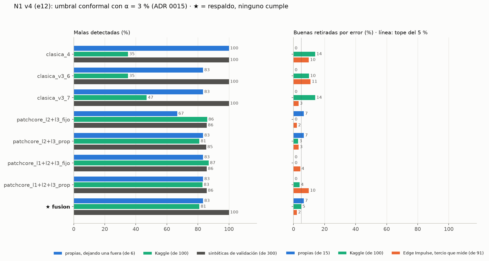
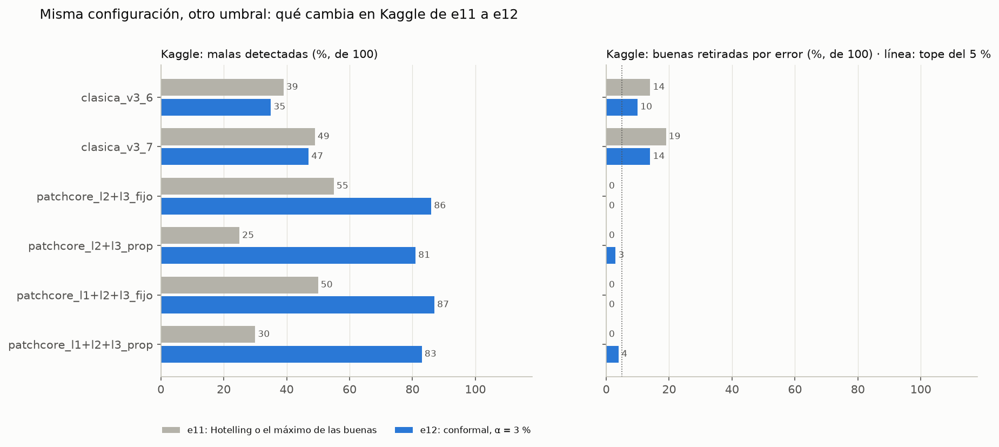

# ADR 0015 · N1 v4: opciones después de e11, y el plan de la v4

**Estado:** corrida (e12): **ningún candidato cumple el criterio**; la regla de respaldo eligió la fusión (clasica_v3_6 + PatchCore l2+l3 fijo), que no se adopta · **Fecha:** 2026-11-27 · **Nivel:** N1 · **Script:** `experimentos/e12_n1_v4.py` (la prueba ciega propia pasa a e13)

## Contexto
En la v3 (e11, [ADR 0014](0014-n1-v3-varios-montajes.md)) ningún candidato cumplió el criterio. Hay tres causas, y las tres están medidas:

1. **El umbral de PatchCore es demasiado prudente.** PatchCore ordena muy bien (AUC 0,96–0,98 en Kaggle), pero su umbral es el mayor puntaje de las buenas. Con ese umbral detecta solo 25–55 de 100 malas en Kaggle.
2. **La cadena clásica no se traslada.** En los dibujos de Kaggle no encuentra el agujero en 94 de 1.000 buenas. Además, con 6–7 rasgos y 14 buenas el umbral de Hotelling se afloja, y detecta 5/6 malas propias.
3. **La regla de respaldo ignoraba las falsas alarmas.** Por eso eligió una fusión que retira 19 de 100 buenas.

Una pista, vista en la v3 y por eso no decide nada: la clásica v3_7 deja pasar m01 (deformada) y PatchCore l1+l2+l3 proporcional deja pasar m04 (borde interior). Fallan en malas distintas.

## Opciones, ordenadas por impacto y costo
Fuentes revisadas el 27 nov 2026. Lo que no se pudo abrir en la fuente va marcado como **no verificado**.

| # | Opción | Qué problema de e11 ataca | Impacto | Costo |
|---|---|---|---|---|
| 1 | **Umbral conformal** con una tasa de falsas alarmas α fijada ([Angelopoulos y Bates, §4.4](https://arxiv.org/abs/2107.07511); [Bates et al., Ann. Stat. 2023](https://arxiv.org/abs/2104.08279)) | El umbral prudente de PatchCore, y el Hotelling que supone normalidad | Alto | Bajo: reusa e11, unos 15 min de GPU |
| 2 | **Regla de respaldo que respeta las falsas alarmas** | La regla débil de la v3 | Alto: evita elegir mal | Muy bajo |
| 3 | **Intervalos Beta-Binomial y modelo jerárquico de tasas por montaje** en PyMC ([ejemplo de PyMC](https://www.pymc.io/projects/examples/en/latest/case_studies/hierarchical_partial_pooling.html); [Brown, Cai y DasGupta 2001](https://doi.org/10.1214/ss/1009213286), **no verificado** en la fuente) | Decir cuánto se espera en un montaje nuevo, con incertidumbre | Medio: no detecta más, pero informa mejor | Bajo a medio |
| 4 | **anomalib** ([Akcay et al., ICIP 2022](https://arxiv.org/abs/2202.08341)): PatchCore de referencia, PaDiM y EfficientAD, y validar con MVTec `metal_nut` | ¿Nuestro PatchCore está bien hecho? Además suma candidatos | Medio | Medio: instalar, caber en 6 GB, y el formulario de MVTec es de Camilo |
| 5 | **Segmentación robusta, desenrollado polar y plantilla dorada** para la clásica (HALCON `polar_trans_image_ext`, **no verificado**) | La clásica no mide en otros montajes, y los cortes radiales | Medio en el montaje propio; bajo en otros | Medio |
| 6 | **Mezcla gaussiana bayesiana** para la nube de buenas ([scikit-learn](https://scikit-learn.org/stable/modules/generated/sklearn.mixture.BayesianGaussianMixture.html)) | Edge Impulse tiene dos fondos | Bajo a medio | Bajo |
| 7 | **Métodos para cambio de dominio**: ADShift ([Cao et al., ICCV 2023](https://arxiv.org/abs/2303.13845)) y RegAD ([Huang et al., ECCV 2022](https://arxiv.org/abs/2207.07361)) | Pasar a un montaje nuevo | Puede ser alto | Alto |
| 8 | **Cero o pocas muestras con CLIP**: WinCLIP ([CVPR 2023](https://arxiv.org/abs/2303.14814)), AnomalyCLIP ([ICLR 2024](https://arxiv.org/abs/2310.18961)) y MuSc ([ICLR 2024](https://arxiv.org/abs/2401.16753)) | Calibrar sin buenas del montaje nuevo | Puede ser alto, pero la latencia en CPU es dudosa | Alto: modelos grandes para una GTX 1060 |
| 9 | **DRAEM** ([ICCV 2021](https://arxiv.org/abs/2108.07610)): defectos sintéticos sobre buenas | Aprovechar el generador sintético | Incierto | Alto: se entrena por montaje |
| 10 | **Regresión logística bayesiana** para la fusión y **optimización bayesiana** de hiperparámetros ([Snoek et al.](https://arxiv.org/abs/1206.2944)) | Pesar la fusión y ajustar hiperparámetros | Bajo: necesita malas o sobreajusta la elección | Medio |

Lo que dice la literatura y cambia el plan:
- **El umbral conformal pide un mínimo de buenas para calibrar.** El umbral es el puntaje número ⌈(n+1)(1−α)⌉ de las n buenas de calibración, ordenadas de menor a mayor, y no existe si α < 1/(n+1) (Angelopoulos y Bates, apéndice D). Con α = 3 % hacen falta al menos 33 buenas, y con 15 el α más bajo posible es 6,25 %.
- **La garantía vale solo si las buenas nuevas vienen del mismo montaje y lote que las de calibración.** Un cambio de cámara o de lote la rompe. Un preprint de 2026 ([Thai y Thai](https://arxiv.org/abs/2610.00236), sin revisión por pares) midió 1,7 veces la tasa nominal al calibrar con pocas buenas. Por eso las falsas alarmas se siguen midiendo aparte.
- **Con n chico, la tasa real varía bastante entre sesiones de calibración.** La tasa condicionada a la calibración sigue una Beta(ℓ, n+1−ℓ), con ℓ = ⌊(n+1)α⌋ (Bates et al., Proposición 1).
- **Nuestro PatchCore tiene contra qué compararse.** El original da un AUROC de 99,7–100 en `metal_nut` ([Roth et al., CVPR 2022](https://arxiv.org/abs/2106.08265), tabla S1), y anomalib da 0,991 con ResNet-18. Eso permite validar nuestra implementación (opción 4).

## Decisión: la v4 ataca el umbral y la regla de respaldo
**La v4 hace las opciones 1 y 2, y suma los intervalos exactos de la opción 3 a cada tasa.** Son las que atacan la falla más grande que se midió: un método que ordena bien y queda mal por el umbral. Además son baratas, porque reusan todo e11. El modelo jerárquico en PyMC (el resto de la opción 3) y anomalib (opción 4) quedan para la v5. Las opciones 7–10 cuestan demasiado para lo que se sabe hoy.

## Criterio de la v4 (fijado antes de correr)
**Candidatos:** la clásica de 4 rasgos de hoy (la de los [ADR 0010](0010-p5-rasgos.md) y [0011](0011-p6-decision.md)), las clásicas v3_6 y v3_7, los 4 PatchCore de e11 y la fusión de la mejor clásica con el mejor PatchCore, elegidas dentro de cada familia con la misma regla. Las configuraciones son las de e11: no se busca nada.

**Umbral conformal partido, con α = 3 %:**
- **Sintéticas:** 150 buenas de entrenamiento ajustan (banco de PatchCore, media y covarianza de la clásica) y otras 150 calibran el umbral. Se mide en las 600 de validación.
- **Kaggle:** 500 buenas de entrenamiento ajustan y 500 calibran. Se mide en las 200 de prueba.
- **Edge Impulse:** las 273 buenas se parten en tres tercios: ajustar, calibrar y medir falsas alarmas. Ahora esa tasa mide algo de verdad, también en PatchCore.
- **Montaje propio:** 15 buenas no alcanzan para α = 3 %. Se usan las reglas de e11 (Hotelling y el máximo dejando una fuera), y se dice así.
- Las particiones se hacen al azar con semilla 0, antes de correr.
- En la fusión, cada parte usa α/2 = 1,5 %, para que las dos juntas no pasen del 3 %.
- Una pieza que la cadena clásica no logra medir se retira siempre y no calibra, como en e11.

**Requisitos:** los mismos del ADR 0014.
1. En el montaje propio: 6/6 malas en la prueba A, ≥ 95 % en la prueba R y < 100 ms en CPU.
2. Falsas alarmas: ≤ 1/15 en las buenas propias, ≤ 5 % en las buenas de prueba de Kaggle y ≤ 5 % en el tercio de Edge Impulse que mide.

**Elección:** entre los que cumplen 1 y 2, gana la mayor detección media (Kaggle y sintéticas). Si hay empate (≤ 2 puntos), gana la más fácil de explicar y después la más rápida.

**Respaldo nuevo:** si ninguno cumple 1 y 2, se toma, entre los que cumplen 2, la mayor detección media. Si ninguno cumple 2, se toma la menor tasa media de falsas alarmas. En los dos casos el resultado se informa como «ninguno cumple» y no se adopta.

**Cómo se informa:** cada tasa va con su IC95 exacto (Clopper-Pearson). El set de prueba de Edge Impulse se corre después de guardar la elección, solo para informar y marcado «no ciego».

## Detalles de implementación (fijados antes de correr e12)
- **Datos:** e12 reusa los rasgos y recortes de e11, porque son las mismas fotos, la misma cadena y la misma regla de polaridad.
- **Partición:** en cada montaje se baraja con `np.random.default_rng(0)` el orden de e11 de sus buenas de calibración. Las sintéticas y Kaggle se parten en dos mitades: la primera ajusta y la segunda calibra. Edge Impulse se parte en tres tercios de 91: ajustan, calibran y miden. La partición queda en `resultados/e12_particion.csv`.
- **Bancos de PatchCore:** todos los grupos que ajustan tienen 91 buenas o más, así que van sin giros, por la regla de e11.
- **Piezas sin medir en la clásica:** se retiran siempre (z = ∞), y no ajustan ni calibran. Así, el n que calibra la clásica puede ser menor que el de PatchCore, y se informa.
- **Fusión:** en los montajes con umbral conformal, cada parte usa su umbral de α/2. En el montaje propio, sus partes usan las reglas de e11, igual que la fusión de e11.
- **Respaldo:** usa el mismo desempate (≤ 2 puntos; luego la más explicable y la más rápida). La «tasa media de falsas alarmas» es el promedio de las tres tasas del requisito 2: propias, Kaggle y el tercio de Edge Impulse que mide.
- **Edge Impulse de prueba (no ciego):** usa el modelo del tercio que ajusta y el umbral del tercio que calibra. Se corre después de guardar la elección.
- **Control:** en el montaje propio, los 6 candidatos de e11 tienen que repetir sus números de e11, porque el código y las reglas son los mismos.
- **Prueba de humo:** `--humo` corre con las muestras chicas de e11 y con α = 10 %, porque con 20–30 buenas que calibran el umbral del 3 % no existe. No guarda la decisión. Corrió en 4 minutos, y el control dio igual a e11. Donde las buenas que calibran y las que miden vienen del mismo grupo, la tasa de falsas quedó cerca de α: de 0 a 7 de 60 en las sintéticas, y de 0 a 1 de 20 en el tercio de Edge Impulse. En Kaggle, en cambio, PatchCore retiró las 60 buenas de prueba. La causa es la muestra chica: el humo toma los primeros 60 archivos de cada grupo, y en Kaggle esas buenas que calibran son muy parejas (desviación del radio equivalente de 1,3 px, contra 5,0 px en las de prueba). En la corrida completa las buenas que calibran son 500 al azar, con una desviación de 6,2 px. Después del humo no se cambió ni el código ni el criterio.
- **Decisión:** se guarda como `enfoque_v4`, con `ninguno_cumple` y `adoptado`.

## Qué cambia en el set ciego propio
Para que el umbral conformal funcione también en el montaje propio, la sesión de fotos del [ADR 0014](0014-n1-v3-varios-montajes.md) pasa de 15 a **50 buenas de calibración**: 16 ajustan (banco y covarianza) y 34 calibran el umbral, una más que el mínimo de 33 para α = 3 %. El total sube a 100 fotos: 50 que calibran, más 25 buenas y 25 malas de prueba. Esas fotos siguen sin tomarse, así que el cambio no compromete la prueba ciega.

## Resultado (e12, 27 nov 2026)
Corrió en 5 minutos en la GTX 1060 de norea, con el código y el criterio del commit 501c8c2. Entre paréntesis va el IC95 exacto, en %.

| Candidato | Propias: malas (A) | Propias: falsas | Giros (R) | Sintéticas: malas | Sintéticas: falsas | Kaggle: malas | Kaggle: falsas | EI, tercio: falsas | ms CPU | Cumple 1 · 2 |
|---|---|---|---|---|---|---|---|---|---|---|
| clasica_4 | 6/6 (54–100) | 0/15 (0–22) | 100 % | 300/300 (99–100) | 8/300 (1–5) | 35/100 (26–45) | 14/100 (8–22) | 9/91 (5–18) | 26 | sí · no |
| clasica_v3_6 | 5/6 (36–100) | 0/15 (0–22) | 95 % | 300/300 (99–100) | 10/300 (2–6) | 35/100 (26–45) | 10/100 (5–18) | 10/91 (5–19) | 26 | no · no |
| clasica_v3_7 | 5/6 (36–100) | 0/15 (0–22) | 95 % | 300/300 (99–100) | 8/300 (1–5) | 47/100 (37–57) | 14/100 (8–22) | 3/91 (1–9) | 27 | no · no |
| PatchCore l2+l3, fijo | 4/6 (22–96) | 1/15 (0–32) | 71 % | 257/300 (81–89) | 10/300 (2–6) | 86/100 (78–92) | 0/100 (0–4) | 2/91 (0–8) | 25 | no · sí |
| PatchCore l2+l3, proporcional | 5/6 (36–100) | 1/15 (0–32) | 93 % | 256/300 (81–89) | 9/300 (1–6) | 81/100 (72–88) | 3/100 (1–9) | 3/91 (1–9) | 31 | no · sí |
| PatchCore l1+l2+l3, fijo | 5/6 (36–100) | 0/15 (0–22) | 81 % | 257/300 (81–89) | 12/300 (2–7) | 87/100 (79–93) | 0/100 (0–4) | 4/91 (1–11) | 31 | no · sí |
| PatchCore l1+l2+l3, proporcional | 5/6 (36–100) | 0/15 (0–22) | 86 % | 257/300 (81–89) | 17/300 (3–9) | 83/100 (74–90) | 4/100 (1–10) | 9/91 (5–18) | 32 | no · no |
| *Fusión (v3_6 + l2+l3 fijo), por respaldo* | *5/6 (36–100)* | *1/15 (0–32)* | *95 %* | *300/300 (99–100)* | *8/300 (1–5)* | *81/100 (72–88)* | *5/100 (2–11)* | *2/91 (0–8)* | *46* | *no · sí* |

**Ninguno cumple.** La regla de respaldo eligió la fusión de clasica_v3_6 con PatchCore l2+l3 fijo, cada una con su umbral de α/2. La fusión cumple el requisito 2 (1/15, 5/100 y 2/91), pero detecta 5 de las 6 malas propias. No se adopta, y el [ADR 0004](0004-n1-enfoque.md) sigue en revisión. `decisiones.json` guarda `enfoque_v4 = fusion` con `ninguno_cumple = true` y `adoptado = false`. Dentro de cada familia, la clásica salió por la tasa media de falsas más baja (ninguna cumple el requisito 2), y PatchCore por la mayor detección entre los que cumplen el 2 (empate con l1+l2+l3 fijo, que es más lento).

Qué se aprende:
- **El umbral conformal arregla lo que tenía que arreglar.** Con la misma configuración, PatchCore pasa de 25–55 a 81–87 malas de 100 en Kaggle, y retira de 0 a 4 de 100 buenas. El orden casi no cambia (AUC 0,96–0,98, como en e11): lo que cambia es el corte. En PatchCore l2+l3 fijo, el umbral baja de 3,72 (el máximo de las buenas) a 2,89. Ojo: e12 ajusta con 500 buenas de Kaggle y e11 con 1.000.

- **Ahora lo que bloquea es el montaje propio.** Con 15 buenas no existe un umbral conformal del 3 %, así que ahí siguen las reglas de e11, y ningún PatchCore pasa de 5/6. El control lo confirma: en las fotos propias, los 6 candidatos de e11 repiten exactamente sus números. Solo clasica_4 detecta las 6, pero retira 14 de 100 buenas en Kaggle (5 que no logra medir) y 9 de 91 en Edge Impulse.
- **La clásica sigue sin trasladarse.** En Kaggle detecta entre 35 y 47 de 100 malas, y su cadena no logra medir entre 50 y 88 de las 500 buenas que calibran.
- **Donde las buenas son intercambiables, la tasa queda cerca de α.** En las sintéticas, las que calibran y las que miden salen del mismo generador, y se retiran entre 8 y 17 de 300 buenas (2,7–5,7 %). Con 150 buenas que calibran, la tasa de una calibración sigue una Beta(4, 147), con percentil 95 de 5,1 %. La excepción es la clásica en el tercio de Edge Impulse: retira 9–10 de 91. De las 9 de clasica_4, 7 son de fondo blanco, y en el tercio que calibró solo 1 buena quedó sobre el umbral. Con una sola partición no se puede separar la mala suerte de la mezcla de dos fondos; la opción 6 apunta a eso.
- **La garantía no pasa de un lote a otro.** Solo para informar (no ciego): en el set de prueba de Edge Impulse, PatchCore retira entre 10 y 20 de 88 buenas (11–23 %), lejos del 3 %. Esas buenas salen más chicas en la foto que las de entrenamiento (radio equivalente mediano de 45,6 px contra 49,3 px), así que son otro lote. Es lo que advertía la literatura: un umbral calibrado en un lote no vale para otro.

### Solo para informar: Edge Impulse de prueba (no ciego)
Se corrió después de guardar la elección, con el modelo del tercio que ajusta y el umbral del tercio que calibra. No decide nada.

| Candidato | Malas (de 103) | Falsas (de 88) | AUC (IC95) |
|---|---|---|---|
| clasica_4 | 36 (26–45 %) | 0 (0–4 %) | 0,75 (0,67–0,81) |
| clasica_v3_6 | 48 (37–57 %) | 0 (0–4 %) | 0,82 (0,75–0,87) |
| clasica_v3_7 | 47 (36–56 %) | 0 (0–4 %) | 0,87 (0,82–0,92) |
| PatchCore l2+l3, fijo | 78 (66–84 %) | 12 (7–23 %) | 0,92 (0,88–0,95) |
| PatchCore l2+l3, proporcional | 96 (86–97 %) | 20 (14–33 %) | 0,97 (0,94–0,98) |
| PatchCore l1+l2+l3, fijo | 85 (74–89 %) | 19 (14–32 %) | 0,92 (0,88–0,95) |
| PatchCore l1+l2+l3, proporcional | 99 (90–99 %) | 10 (6–20 %) | 0,98 (0,96–0,99) |
| Fusión (v3_6 + l2+l3 fijo) | 79 (67–84 %) | 11 (6–21 %) | 0,93 (0,90–0,96) |

### Lo que sigue
La v4 confirma que el umbral era la falla de PatchCore. Lo que queda ya no depende del método: el requisito 1 se mide con 15 buenas propias, y con eso no hay umbral conformal. Hipótesis (**no verificada**): con 34 buenas propias o más que calibren, PatchCore pasaría de 5/6, como pasó en Kaggle. La v5 va en un ADR nuevo, con su criterio fijado antes de correr, y su primer paso es una sesión de fotos propias. El modelo jerárquico en PyMC y anomalib con `metal_nut` siguen como opciones para después.

**Análisis post hoc (no decide la v4).** Después de la corrida se armaron, con los puntajes de `e12_puntajes.csv`, las 12 fusiones posibles entre una clásica y un PatchCore, con α/2 por parte. Solo una cumple los requisitos 1 y 2: **clasica_4 + PatchCore l2+l3 fijo**, con 6/6 y 1/15 propias, 42/42 en giros, 81/100 malas y 5/100 falsas en Kaggle, 2/91 en el tercio de Edge Impulse y 46 ms. Queda al límite en dos requisitos (1/15 y 5/100), y salió de mirar 12 combinaciones, así que esos números son optimistas. No pudo salir en la v4 porque la regla elige primero una clásica por familia, y ganó v3_6 por tener menos falsas en promedio. Por eso solo puede probarse con datos nuevos. Es el candidato natural para fijar en la v5 antes de tomar las fotos.

**Tamaño de la calibración propia.** Con α/2 = 1,5 % por parte, el umbral de la fusión existe solo con 66 buenas o más que calibren (1/(n+1) ≤ 1,5 %). Con las 34 del plan de arriba no existe. Entre 66 y 132, cada parte usa el máximo de las que calibran, y su tasa real sigue una Beta(1, n) (Bates et al., Prop. 1). Si las dos partes fueran independientes, la tasa de la fusión pasaría del 5 % con probabilidad 15 % para n = 66 y 4 % para n = 100 (simulación propia; con partes correlacionadas es menor).

## Lo que no se hace
- Cambiar el criterio del [ADR 0014](0014-n1-v3-varios-montajes.md) después de ver e11. La v4 es un ADR nuevo, con su propio criterio.
- Elegir con el set de prueba de Edge Impulse ni con el set ciego propio.
- Llenar el formulario de MVTec por Camilo. Si se valida contra `metal_nut`, ese paso es suyo.

Volver al [árbol](../arbol.md).
