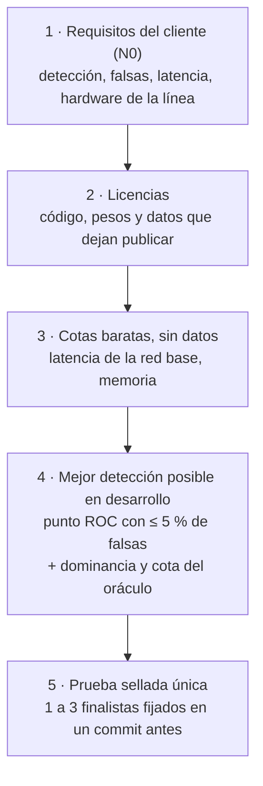

# ADR 0019 · v6: cómo elegir entre métodos y combinaciones sin probarlas todas (el embudo)

**Estado:** propuesta, pedida por Camilo el 28 nov 2026 · **Fecha:** 2026-11-28 · **Nivel:** N1 (método de decisión) · **Script:** `scripts/combinaciones.py` (solo informa en MANTA) · No toca la corrida de e13 ni el criterio del [ADR 0017](0017-n0-v2-estado-del-arte.md)

## Contexto
e13 compara 8 métodos, uno por uno. La v6 quiere probar también combinaciones: fusionar la clásica con la IA, sumar una clásica de superficie y armar ensambles de varias IA. Con 8 métodos hay 255 conjuntos posibles para una regla «retira si A o B o …», y las fusiones de puntajes tienen pesos continuos. Probarlas todas en la prueba sellada tiene dos problemas:

- **La prueba se gasta.** Una prueba sellada vale una vez. Si se eligen 255 opciones mirándola, alguna pasa por suerte, y el resultado ya no mide el desempeño en piezas nuevas.
- **Cuesta tiempo de GPU** que el servidor no tiene: e13, con 8 métodos solos, tarda varias horas.

Hace falta un método que descarte lo imposible sin probarlo y que llegue a la prueba sellada con 1 a 3 finalistas.

## Decisión: el embudo
Cada etapa descarta con datos más caros que la anterior. Ninguna etapa mira la prueba sellada.

1. **Requisitos del cliente.** Salen del N0 y de normas o referencias citables ([ADR 0017](0017-n0-v2-estado-del-arte.md), [ADR 0020](0020-regla-justificacion-de-valores.md)).
2. **Licencias.** Se descarta lo que no deja publicar resultados ni usar el código, los pesos o los datos.
3. **Cotas baratas.** Si la red base sola ya tarda más de 100 ms por pieza en la CPU de la línea, el método no puede cumplir, y sale sin ajustarlo ([medición previa del ADR 0017](0017-n0-v2-estado-del-arte.md#medición-previa-de-latencia-28-nov-2026-no-decide)). Lo mismo vale si no cabe en la memoria de la máquina de la línea. En e13 estos métodos se corrieron igual, para mostrar cuánto se gana en detección y cuánto cuesta en tiempo. En la v6 se pueden seguir informando, pero no llegan a la prueba sellada.
4. **Mejor detección posible en desarrollo.** Se mide con datos que no son la prueba sellada. La pregunta es: con el mejor umbral posible que deje 5 % de falsas o menos, ¿cuántas malas detecta? Es el punto ROC con 5 % de falsas. Como elige el umbral mirando esos datos, es optimista: si ni así se llega al 98 % de detección, el umbral conformal tampoco llegará. Aquí se aplican las dos reglas de poda de abajo.
5. **Prueba sellada única**, con 1 a 3 finalistas y la regla de elección fijados en un commit antes, como en e13.

## Dos reglas de poda

### Dominancia (frente de Pareto)
Un método sale si otro es igual o mejor que él en detección, falsas, latencia y licencia, en las dos golillas, y mejor en al menos una de esas cosas.

- **«Mejor» tiene que ser más que el ruido.** No gana nadie por 1 pieza de 74. Como los dos métodos se miden sobre las mismas piezas, la comparación es la prueba exacta de McNemar: cuenta solo las piezas en que discrepan y pregunta si la diferencia puede ser azar (p < 0,05, dos colas, la misma confianza del 95 % de los IC del ADR 0017). Es la prueba estándar para comparar dos clasificadores en el mismo conjunto de prueba (Dietterich, 1998, *Neural Computation* 10(7)).
- **La latencia cuenta contra el requisito.** Lo que importa es si cumple los 100 ms o no. Dos métodos que no cumplen quedan iguales en latencia. Lo mismo vale para la licencia.
- **La dominancia poda candidatos solos, no miembros de una combinación.** Un método dominado puede atrapar malas que el otro no ve, y en una regla «o» puede servir. Las combinaciones se podan con la regla siguiente.

### Cota del oráculo
**Para «retira si A o B».** Con el umbral de 5 % de falsas de cada miembro, la detección del conjunto es la unión de las malas que detecta cada uno. Es el techo: ninguna regla «o» con 5 % de falsas o menos detecta más. Sus falsas son al menos las de cada miembro, así que cada umbral tiene que ser igual o más estricto que el del punto ROC, y subir un umbral solo pierde malas. **Si la unión no llega al criterio, ninguna combinación «o» de esos métodos cumple.**

**Poda del retículo.** Los conjuntos se recorren de menor a mayor: primero los métodos solos, después los pares, después los tríos. Un conjunto sale sin probarse si contiene a otro que ya:
- pasa de 100 ms en serie, porque las latencias se suman y al agregar miembros solo crecen; o
- pasa de 5 % de falsas con los umbrales fijos de cada miembro, porque la unión de buenas retiradas solo crece.

**Para fusiones de puntajes** (por ejemplo, sumar el puntaje de la clásica y el de PatchCore), la unión no es un techo: una suma puede rescatar una pieza que cada uno pierde por separado. Lo que sí se mira es si fallan en las mismas piezas. Para eso se cuentan las malas que pierden todos a la vez y el solapamiento de las malas perdidas por cada par (índice de Jaccard). Si dos métodos pierden casi las mismas malas, fusionarlos no ayuda.

## Qué hace `scripts/combinaciones.py`
Lee `resultados/e13_metodos_puntajes.csv` y `e13_metodos.csv`. No usa GPU. Escribe:

| Archivo | Qué trae |
|---|---|
| `e13_punto5.csv` | Por método y golilla: malas y falsas en el punto ROC de 5 % y con el umbral conformal de e13 |
| `e13_dominancia.csv` | Los pares «A domina a B» |
| `e13_combinaciones.csv` | Cada conjunto probado del retículo: su latencia en serie, sus malas y falsas con los umbrales de e13, la cota del oráculo y si alcanza el criterio |
| `e13_perdidas_pares.csv` y `e13_perdidas_todos.csv` | Solapamiento de malas perdidas por par, y las malas que pierden todos (con su defecto) |
| `e13_combinaciones.json` | El resumen: frente de Pareto, conjuntos podados sin probar, si algún conjunto que cabe en 100 ms alcanza y si alcanzaría sin tope de latencia |

**En MANTA, todo esto solo informa.** La prueba de e13 ya se miró, así que elegir con ella sería elegir con la prueba. Sirve para dos cosas: describir el techo de lo que se puede lograr con estos 8 métodos y orientar qué candidatos merece la pena preparar para la v6. Para que el embudo decida, la etapa 4 se corre con datos de desarrollo, y después va una prueba sellada nueva.

Probado con los resultados del humo (Kaggle y Edge Impulse, 40 piezas por clase): el PatchCore propio queda solo en el frente, porque es el único que cumple los 100 ms y los demás no se distinguen de él en detección ni en falsas. Los 5 pares que lo contienen se podan sin probarse. Ni sin tope de latencia la unión alcanza en Edge Impulse: hay 3 malas que todos pierden. Pruebas: `tests/test_combinaciones.py`.

## Candidatos de la v6 (todos solo informan en MANTA)
El [catastro](../estado-del-arte.md#8-lo-que-e13-no-compara-catastro-de-la-v6-por-familia-28-nov-2026) pasó por las etapas 2 y 3 del embudo todo lo que trae anomalib 2.7.1 y la clásica que falta. Quedan estos:

1. **Clásica de superficie:** color en HSV o Lab, textura (GLCM, LBP y Gabor), top-hat y black-hat, y una plantilla dorada con modelo de variación (media y desviación por píxel, tras alinear). Se combina con los rasgos de forma mediante un clasificador de una clase (SVM de una clase, isolation forest, LOF, GMM o Mahalanobis).
2. **IA de familias que e13 no tiene:** FastFlow (flujos), STFPM (maestro-alumno), DFKDE y DFM (densidad), DRAEM (anomalías sintéticas, sin subir DTD) y GANomaly y FRE (reconstrucción). Su latencia está por medir.
3. **Los mismos métodos, optimizados:** exportados a OpenVINO u ONNX y cuantizados a INT8, con la licencia de cada herramienta verificada antes.
4. **Combinaciones:** fusión o cascada de la clásica con la IA, y ensambles de IA, con la latencia por media y p99.

Quedan fuera, con la etapa que los saca:
- **Etapa 2, licencias:** CS-Flow, U-Flow y CFA (el código original no declara licencia o es AGPL), EfficientAD y DSR (pesos sin licencia), RAD y SuperADD (DINOv3), y AnomalyVFM y VLM-AD.
- **Etapa 3, cota de latencia:** los métodos con WRN-50 o con un ViT-B o mayor.

## Estadística de la prueba sellada nueva
- **Cuántas malas hacen falta: 149 o más por tipo.** Con 149 malas y ninguna perdida, la no detección queda bajo 2 % con 95 % de confianza (1 − 0,05^(1/149) ≤ 0,02; el mismo cálculo del ADR 0017). MANTA trae 72 y 74, y por eso e13 decide con el criterio puntual del AIAG y no con una prueba de hipótesis. Si la v6 quiere probar con confianza, como pide la VDI 2632-3.1, necesita un set de ese tamaño.
- **Corrección por comparaciones múltiples, si llegan 2 o 3 finalistas:** el método de Holm, que controla la probabilidad de aprobar por suerte a alguno de los finalistas sin ser tan conservador como Bonferroni (Holm, 1979, *Scandinavian Journal of Statistics* 6(2); **no verificado** en la fuente). Con un solo finalista no hace falta.

## Combinaciones que entran al embudo
| Tipo | Ejemplo | Cómo se poda |
|---|---|---|
| Clásica con clásica | Forma (P1–P6) más superficie (color, textura, plantilla dorada) | Licencias (OpenCV, scikit-image y scikit-learn), cota de latencia y dominancia |
| Clásica con IA, fusión de puntajes | Puntaje de forma más puntaje de PatchCore, cada uno normalizado por su calibración | Latencia en serie y solapamiento de malas perdidas |
| Clásica con IA, cascada | La clásica juzga primero; la IA mira solo las piezas en que la clásica duda | Latencia con la regla de abajo y cota del oráculo de la regla «o» |
| IA con IA (ensamble) | Unión de dos métodos de familias distintas | Latencia en serie y cota del oráculo |

### Cómo se mide la latencia de una combinación (regla de la v6)
En e13 cada método tarda casi lo mismo en cada pieza, así que su mediana basta. Una cascada no: la mayoría de las piezas sale en 13 ms, y unas pocas tardan lo que tarda la IA. La mediana escondería la rama lenta. Por eso, desde la v6 la latencia se exige en dos partes, cada una con su fuente:

- **Ritmo: media ≤ 100 ms por pieza.** Es la referencia de fabricante de 600 piezas por minuto ([ADR 0017](0017-n0-v2-estado-del-arte.md)). Con un solo inspector y una cola, el ritmo lo fija el tiempo medio: si es mayor que el tiempo entre piezas, la cola crece sin fin.
- **Plazo: p99 ≤ el tiempo que la pieza tarda de la cámara a la boquilla**, contando la espera en la cola. Ese tiempo es 250 mm dividido por la velocidad de la cinta, menos la captura (5 ms) y la válvula (10 ms) ([ADR 0012](0012-p7-linea.md)). A 600 piezas por minuto, la cinta va a ≈ 850 mm/s (interpolando la tabla del ADR 0012), así que el plazo es de ≈ 280 ms (estimación; se mide con `golillas/linea.py`). El p99 sale del criterio del mismo ADR: el 99 % de las malas marcadas tiene que salir de la cinta, así que a lo más el 1 % puede llegar tarde.

Para un método solo, de tiempo casi constante, las dos partes equivalen a la mediana de e13. Ni e13 ni su decisión cambian.

## Lo que falta para que la v6 decida
- **Datos de desarrollo con malas del mismo tipo de golilla.** MANTA no trae malas fuera de su prueba. Sin ellas, la etapa 4 solo se puede correr en los sets que informan (Kaggle, Edge Impulse y Roboflow), que son otros montajes.
- **Una prueba sellada nueva.** La de MANTA ya se usó en e13. Opciones por verificar: la MANTA completa (otra resolución, pero quizás las mismas piezas, y entonces no sirve), un set público nuevo o fotos propias.
- **Justificar cada valor de este ADR** según el [ADR 0020](0020-regla-justificacion-de-valores.md). Ya tienen su fuente el 5 % de falsas y el 98 % de detección (AIAG), los 100 ms (fabricante) y el p < 0,05 de McNemar (Dietterich, 1998, y la confianza del 95 % del ADR 0017). Falta justificar el límite de 1 a 3 finalistas.

## Lo que no se hace
- Usar el resultado de `combinaciones.py` en MANTA para elegir un método o una combinación.
- Cambiar el criterio o la decisión de e13.

Volver al [árbol](../arbol.md).
