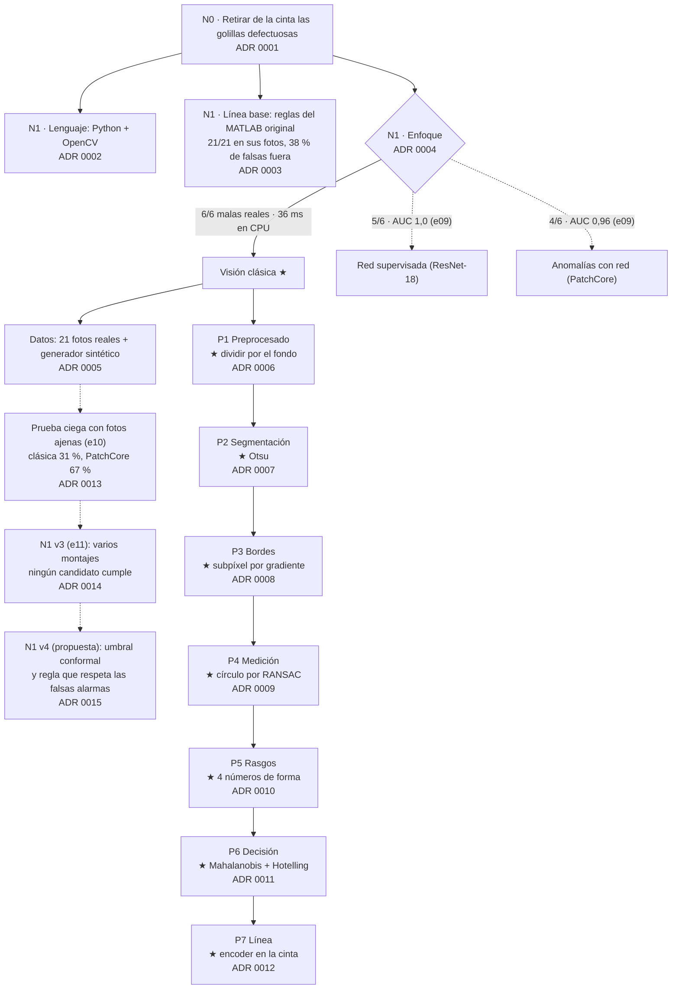

# Árbol de decisiones (N0 → N3)

El proyecto se diseñó de lo general a lo particular, sin saltar niveles:

- **N0**: qué se quiere lograr, con qué límites y cómo se sabe si se logró.
- **N1**: los enfoques posibles; se elige uno midiendo.
- **N2**: los procesos (pasos) del enfoque elegido.
- **N3**: por cada proceso, todas las técnicas candidatas, probadas con los mismos datos; gana la que cumple un criterio escrito antes de mirar el ranking.

Cada decisión tiene su registro (ADR) con la tabla de resultados, el gráfico y el script que lo reproduce.

## N3: lo que se probó en cada proceso

| Proceso | Técnicas probadas | Elegida | Criterio | ADR |
|---|---|---|---|---|
| P1 Preprocesado | ninguno, gauss, mediana, bilateral, CLAHE, restar fondo, dividir por fondo, dividir + gauss (8) | dividir por el fondo | IoU medio de las 11 segmentaciones | [0006](adr/0006-p1-preproceso.md) |
| P2 Segmentación | Otsu, triángulo, adaptativo media/gauss, Bradley, Sauvola, k-means, Canny + relleno, GrabCut, watershed, Chan-Vese (11) | Otsu | mejor IoU con topología perfecta en buenas; empate → la más rápida | [0007](adr/0007-p2-segmentacion.md) |
| P3 Bordes | Sobel, Scharr, Prewitt, LoG, Canny, Canny automático, contorno, subpíxel iso, subpíxel gradiente (9) | subpíxel por gradiente | error de radio + dispersión de puntos | [0008](adr/0008-p3-bordes.md) |
| P4 Medición | Kåsa, Taubin, geométrico, robusto, RANSAC, elipse, mínimo círculo, momentos, Hough, Hough alt. (10) | RANSAC | error medio en buenas y con defecto | [0009](adr/0009-p4-medicion.md) |
| P5 Rasgos | 17 rasgos de forma, borde, Fourier y textura | 4 rasgos | selección hacia adelante por AUC | [0010](adr/0010-p5-rasgos.md) |
| P6 Decisión | tolerancias, Mahalanobis (χ² y Hotelling), Isolation Forest, OC-SVM, logística, árbol, SVM, random forest, k-NN (10) | Mahalanobis + Hotelling | 100 % de malas reales; menos falsas alarmas | [0011](adr/0011-p6-decision.md) |
| P7 Línea | temporizador, encoder, encoder + segundo sensor (3) | encoder | ≥ 99 % de malas retiradas y ≤ 1 % de buenas arrastradas | [0012](adr/0012-p7-linea.md) |

Volver al [índice](README.md).
